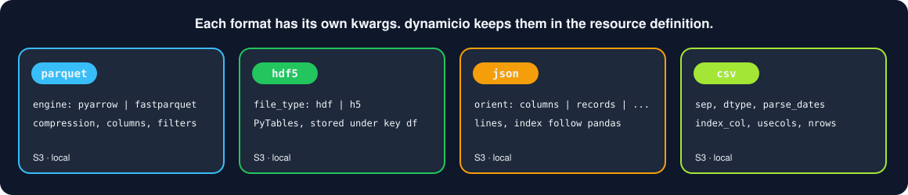
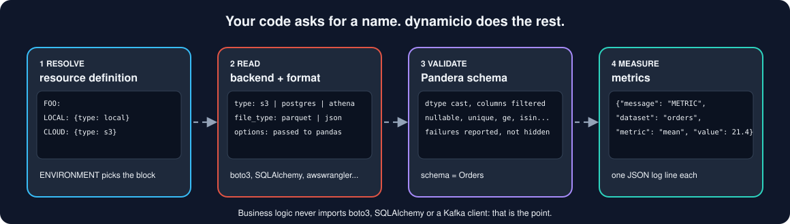
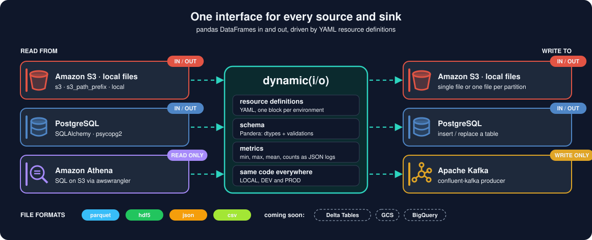
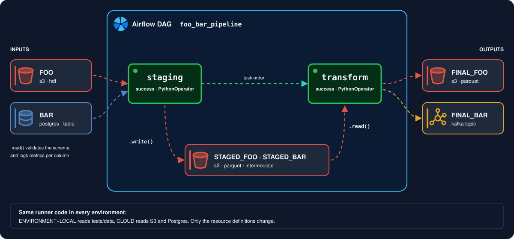

[](https://github.com/VorTECHsa/dynamicio/actions/workflows/build_and_publish.yml)
[](https://codecov.io/gh/VorTECHsa/dynamicio)
[](https://join.slack.com/share/enQtMzg2Nzk3ODY3MzEzNi0yNTU1ZmIyN2JkMGFhZjhhZWVjNzA2OWUzNWIyMjMyYmYzZmE4MzBjYWQ3YjdhNjU1MGU2NjFkNzMyZDllMzE2?raw=True)

 

A repository for hosting the `dynamicio` library, used as a wrapper for `pandas` i/o operations.

-- Logo illustrated by [Nick Loucas](https://www.linkedin.com/in/nickloucas/)

## Table of Contents
- [Why wrap your i/o?](https://github.com/VorTECHsa/dynamicio/tree/master#why-wrap-your-io)
  * [Managing various Resources](https://github.com/VorTECHsa/dynamicio/tree/master#managing-various-resources)
  * [Managing Various Data Types](https://github.com/VorTECHsa/dynamicio/tree/master#managing-various-data-types)
  * [Validations & Metrics Generation](https://github.com/VorTECHsa/dynamicio/tree/master#validations--metrics-generation)
  * [Testing (Running Local Regression Tests)](https://github.com/VorTECHsa/dynamicio/tree/master#testing-running-local-regression-tests)
  * [So, what do we do about these?](https://github.com/VorTECHsa/dynamicio/tree/master#so-what-do-we-do-about-these)
  * [The Solution](https://github.com/VorTECHsa/dynamicio/tree/master#the-solution)
  * [Main features](https://github.com/VorTECHsa/dynamicio/tree/master#main-features)
- [Supported sources and data formats](https://github.com/VorTECHsa/dynamicio/tree/master#supported-sources-and-data-formats)
  * [S3 I/O](https://github.com/VorTECHsa/dynamicio/tree/master#s3-io)
  * [Athena I/O](https://github.com/VorTECHsa/dynamicio/tree/master#athena-io)
  * [Coming soon](https://github.com/VorTECHsa/dynamicio/tree/master#coming-soon)
- [Installation](https://github.com/VorTECHsa/dynamicio/tree/master#installation)
- [API Documentation](https://github.com/VorTECHsa/dynamicio/tree/master#api-documentation)
- [How to use](https://github.com/VorTECHsa/dynamicio/tree/master#how-to-use)
  * [Keywords](https://github.com/VorTECHsa/dynamicio/tree/master#keywords)
  * [Let's start](https://github.com/VorTECHsa/dynamicio/tree/master#lets-start)
    + [Step 1: Resource Definitions](https://github.com/VorTECHsa/dynamicio/tree/master#step-1-resource-definitions)
    + [Step 2: Defining your environment variables](https://github.com/VorTECHsa/dynamicio/tree/master#step-2-defining-your-environment-variables)
    + [Step 3: Read in your resource definitions](https://github.com/VorTECHsa/dynamicio/tree/master#step-3-read-in-your-resource-definitions)
    + [Step 4: Loading the data resources](https://github.com/VorTECHsa/dynamicio/tree/master#step-4-loading-the-data-resources)
      - [Step 4.1. Pandera models](https://github.com/VorTECHsa/dynamicio/tree/master#step-41-pandera-models)
      - [Step 4.1b. `SCHEMA_FROM_FILE`](https://github.com/VorTECHsa/dynamicio/tree/master#step-41b-schema_from_file)
      - [Step 4.2. Use the dynamicio cli](https://github.com/VorTECHsa/dynamicio/tree/master#step-42-use-the-dynamicio-cli)
      - [Step 4.3a: Loading from `S3`](https://github.com/VorTECHsa/dynamicio/tree/master#step-43a-loading-from-s3)
      - [Step 4.3b: Loading from `Postgres`](https://github.com/VorTECHsa/dynamicio/tree/master#step-43b-loading-from-postgres)
      - [Step 4.3c: Loading from `Athena`](https://github.com/VorTECHsa/dynamicio/tree/master#step-43c-loading-from-athena)
    + [Step 5: Writing out](https://github.com/VorTECHsa/dynamicio/tree/master#step-5-writing-out)
    + [Step 6: Full Code](https://github.com/VorTECHsa/dynamicio/tree/master#step-6-full-code)
  * [Utilising `asyncio`](https://github.com/VorTECHsa/dynamicio/tree/master#utilising-asyncio)
- [Testing Locally](https://github.com/VorTECHsa/dynamicio/tree/master#testing-locally)
  * [Declaring the expected output](https://github.com/VorTECHsa/dynamicio/tree/master#declaring-the-expected-output)
  * [Asserting lazily with `dynamicio.testharness`](https://github.com/VorTECHsa/dynamicio/tree/master#asserting-lazily-with-dynamiciotestharness)
  * [Choosing the environment](https://github.com/VorTECHsa/dynamicio/tree/master#choosing-the-environment)
  * [Recommended testing practices](https://github.com/VorTECHsa/dynamicio/tree/master#recommended-testing-practices)
- [Last notes](https://github.com/VorTECHsa/dynamicio/tree/master#last-notes)

<small><i><a href='http://ecotrust-canada.github.io/markdown-toc/'>Table of contents generated with markdown-toc</a></i></small>

## Why wrap your i/o?

Working with `pandas` dataframes has opened up a new world of potential in Data Science. However,
if you are using `pandas` to support production pipelines, whether ML or ETL, you end up having
a big part of your code be concerned with I/O operations. 

### Managing various Resources
First, it's the various type of resources you need to interact with; object storage (S3 or GCS)
databases (Athena, Big Query, Postgres), Kafka and many more. For each of these, you have 
dependencies on various libraries such as `boto3`, `awswrangler`, `SQLAlchemy`,
`tables` (for `hdf5`), `confluent-kafka` and many more. 

### Managing Various Data Types


Then it's the various data types you need to handle, `parquet`, `hdf5`, `csv`, `json` and many
others, each of which come with their own set of configuration `kwargs`, things like the 
orientation of the dataset (`json`) or the parquet engine you want 
to use behind the scenes (`pyarrow` or `fastparquet`).

### Validations & Metrics Generation
Then, it's the need to validate your expectations on the datasets; things like unique or
null values being allowed in a column, allowing only a specific set of categorical values, or
numerical values within a specified range. And what about metrics generation? The ability to
monitor data distributions and how various metrics change with every run, is a significant
aspect of monitoring the quality of your solution. 

### Testing (Running Local Regression Tests)
Finally, what about testing your code in different environments? Take, for instance, a traditional
setup where you have the following 4 environments to work against:

- Local;
- Develop;
- Staging, and;
- Production.

Configuring your code to work against the last 3 `Develop, Staging and Production` can easily be done through
environment variables, but what about testing locally? What if you want to run your pipelines locally? 
Well, you can, but usually that entails a big deal of mocking calls to external services. Instead, wouldn't
it be great if you could seamlessly direct your I/O operations to local sample data.

### So, what do we do about these? 
This proliferation of I/O operations leads to the emergence of glue code, which can be very difficult to manage. The problem is highlighted 
as an **ML-System Anti-Pattern** in [Hidden Technical Debt in Machine Learning Systems](https://papers.nips.cc/paper/2015/file/86df7dcfd896fcaf2674f757a2463eba-Paper.pdf)

> ...ML researchers tend to develop general purpose solutions as self-contained packages. A wide variety of these are
> available as open-source packages at places like `ml-oss.org`, or from in-house code, proprietary packages, and cloud-based platforms.
>
> Using generic packages often results in a **glue code** system design pattern, in which a massive amount of supporting
> code is written to get data into and out of general-purpose packages. **Glue code** is costly in the long
> term because it tends to freeze a system to the peculiarities of a specific package; testing alternatives
> may become prohibitively expensive. In this way, using a generic package can inhibit improvements, because it
> makes it harder to take advantage of domain-specific properties or to tweak the objective function to
> achieve a domain-specific goal. Because a mature system might end up being (at most) 5% machine learning
> code and (at least) 95% glue code, it may be less costly to create a clean native solution rather
> than re-use a generic package.

### The Solution

Quoting from the same paper:

> An important strategy for combating glue-code is to wrap black-box packages into common API's. This allows supporting
> infrastructure to be more reusable and reduces the cost of changing packages.



Dynamicio (or dynamic(i/o)) serves exactly that; it serves as a convenient wrapper around `pandas` I/O operations. It's a manifestation of 
the dependency inversion principle--a layer of indirection if you want--which keeps your code DRY and increases re-usability, effectively 
decoupling business logic from the I/O layer.

### Main features
`dynamic(i/o)` supports:
* seamless transition between environments; 
* abstracting away from resource and data types through `resource definitions`; 
* honouring your expectations on data through `schema definitions`, declared as [Pandera](https://pandera.readthedocs.io) models;
* metrics auto-generation (logging) for monitoring purposes.

## Supported sources and data formats




- **S3** (or local) Input & Output, for single files (`type: s3`) and for prefixes holding many files (`type: s3_path_prefix`):
  - `parquet`
  - `h5`
  - `json`
  - `csv`
- **Postgres** Input & Output
- **Athena** Input only (`type: athena`)
- **Kafka** Output

### S3 I/O

S3 is accessed directly through `boto3`, with one client shared per process (safe across forked workers):

* **Single files** (`type: s3`): parquet is read with one `GetObject` and parsed in memory, and written with one
  `PutObject` (multipart above 16 MiB), using the same `pandas`/`pyarrow` options as local I/O. `awswrangler` is only
  used when you pass an option that only it supports, and for `csv`/`json`.
* **Prefixes** (`type: s3_path_prefix`): objects are listed and fetched by a pool of 32 threads, one request per object.
  Parquet objects are parsed in memory as they arrive, so parsing overlaps the download. `no_disk_space: true` is still
  accepted.
* **No `awscli` or `s3fs`**: they are no longer dependencies, so installing `dynamicio` no longer puts an `aws` command
  in your environment. Credentials come from the usual `boto3` chain (environment, profile, IAM role).

Compared with the previous implementation, single-file reads are about 2.4x faster and writes about 1.3x faster, and
prefix reads/writes are on par or better, using less CPU per call
([benchmarks](https://github.com/VorTECHsa/dynamicio/blob/master/docs/perf-s3-io.md),
[design decision](https://github.com/VorTECHsa/dynamicio/blob/master/docs/adr/0001-direct-boto3-s3-io.md)).

#### Parquet prefixes that changed schema over time

Prefixes accumulate objects over the years, so older objects may lack columns that were added to the schema later.
When reading a parquet `s3_path_prefix`, such objects are read with the columns they do have and the missing columns
are filled with nulls; a warning lists each column and how many objects lacked it:

```text
[s3] Some objects under s3://bucket/live/state/ lack columns that are filled with nulls: {'status': 2} (objects lacking each column)
```

This tolerance is deliberate and bounded: a column that is missing from *every* object raises a `ValueError`, and a
schema column typed as a non-nullable dtype (e.g. `int64`) still fails, because nulls cannot be represented. Single-file
reads and `local_batch` are strict. Watch the warning if the missing data would indicate a real upstream problem rather
than an old schema ([design decision](https://github.com/VorTECHsa/dynamicio/blob/master/docs/adr/0002-tolerate-missing-columns-in-parquet-prefix-reads.md)).

### Athena I/O

`type: athena` resources run a SQL query on AWS Athena and return the result as a dataframe, through
[AWS SDK for pandas](https://aws-sdk-pandas.readthedocs.io/) (`awswrangler`). Mix `WithAthena` into your IO class, as with the other sources.
Athena is read-only: writing raises `NotImplementedError`.

```yaml
EVENTS_ATHENA:
  CLOUD:
    type: athena
    athena:
      s3_output: s3://my-athena-results-bucket/dynamicio/   # required: where Athena writes query results
      database: analytics        # optional, default "default"
      workgroup: primary         # optional
      region_name: eu-west-1     # optional: builds a dedicated boto3 session for that region
      query: SELECT id, ts FROM events WHERE day = '2024-01-01'   # optional here, or pass `query=` when instantiating the IO class
```

Notes:

* The query comes from the resource definition or from `query=...` at instantiation; the latter wins, as do any other
  options, which are passed to `awswrangler.athena.read_sql_query` (unknown ones are dropped). A read without a query raises `ValueError`.
* Credentials and region come from the usual `boto3` chain and the process-wide shared session, unless `region_name` is set.
* `ctas_approach` defaults to `False`: the query runs as is and column names keep the case used in the `SELECT`. Pass
  `ctas_approach=True` to use awswrangler's CTAS path (faster for large results, but it creates a temporary Glue table
  and lower-cases column names).
* awswrangler returns nullable pandas dtypes (`Int64`, `string`, `boolean`) and Python `date` objects for `date`
  columns. When the resource declares a schema, dynamicio casts to the declared dtypes, so declare them.
* **Breaking (9.0):** the `s3_staging_dir` key from the PyAthena era was removed. Rename it to `s3_output` (same
  value); a definition that still has it fails to load with an error saying so.

### Coming soon
- **Delta Tables** (pending)
- **GCS** (pending)
- **BigQuery** (pending)

## Installation

```shell
>> pip install dynamicio
# or, in a uv project
>> uv add dynamicio
```

To contribute, see [CONTRIBUTING.md](https://github.com/VorTECHsa/dynamicio/blob/master/CONTRIBUTING.md) (the project is managed with [uv](https://docs.astral.sh/uv/)).

## API Documentation
Read our docs here: https://vortechsa.github.io/dynamicio/

## How to use

We will go over an end-to-end example for reading and writing a single dataset, covering:

1. all components involved and how they are configured, and;
2. how these components are pieced together

You can find this example under the demo directory of this repo.

### Keywords:

- **resource definitions**: the YAML files that say *where* each dataset lives (path, bucket, table, topic...) for each environment.
- **source configs**: what `IOConfig` parses a resource definition into, one per dataset; you hand one to an IO class to read or write that dataset.
- **schema definitions**: the Python classes (Pandera models, see Step 4.1) that say *what* a dataset looks like: columns, dtypes, validations and metrics.
  Older projects may still declare them in YAML or as plain dictionaries; both keep working.

### Let's start

Suppose you want to ingest the `foo` and `bar` datasets, respectively from `S3` and `Postgres` and stage them
to S3 for further processing.

Assume you want to build a pipeline that looks something like the image below:



Assume the below repository structure, which implements this pipeline, for the purpose of this tutorial. It is also the
structure we recommend for a data pipeline repository (see [Recommended project structure](#recommended-project-structure) below):

```shell
demo
├── __init__.py
├── src
│   ├── __init__.py
│   ├── __main__.py
│   ├── config
│   │   ├── __init__.py
│   │   ├── constants.py
│   │   └── environment.py
│   ├── resources
│   │   ├── __init__.py
│   │   ├── definitions
│   │   │   ├── staging_input.yaml
│   │   │   ├── staging_output.yaml
│   │   │   ├── transform_input.yaml
│   │   │   └── transform_output.yaml
│   │   ├── io.py
│   │   └── schemas
│   │       ├── __init__.py
│   │       ├── input.py
│   │       └── processed.py
│   └── runners
│       ├── __init__.py
│       ├── staging.py
│       ├── transform.py
│       └── utils
│           ├── __init__.py
│           └── runner_selection.py
└── tests
    ├── __init__.py
    ├── config
    │   ├── __init__.py
    │   └── constants.py
    ├── data
    │   ├── input
    │   │   ├── bar.parquet
    │   │   └── foo.csv
    │   ├── processed
    │   │   └── expected
    │   │       ├── final_bar.parquet
    │   │       └── final_foo.parquet
    │   └── raw
    │       └── expected
    │           ├── staged_bar.parquet
    │           └── staged_foo.parquet
    ├── resources
    │   ├── __init__.py
    │   └── test_prefix_schema_evolution.py
    ├── runners
    │   ├── __init__.py
    │   ├── conftest.py
    │   ├── test_staging.py
    │   ├── test_transform.py
    │   └── utils
    │       ├── __init__.py
    │       └── test_runner_selection.py
    └── test_pipeline.py
```

##### Recommended project structure

Everything that describes *what data the pipeline touches* lives together under `src/resources`; everything that describes
*what the pipeline does with it* lives outside:

| Path | Holds |
|---|---|
| `src/resources/definitions/*.yaml` | Resource definitions: where each dataset lives per environment, its format and options. YAML, so a bucket or path can change without touching code |
| `src/resources/schemas/*.py` | The datasets' Pandera models: columns, dtypes, validations, metrics. One module per definitions file (`input.py` next to `definitions/staging_input.yaml`), or per runner and direction in a bigger pipeline (`stage.py`, `transform.py`, ...) |
| `src/resources/io.py` | The `UnifiedIO`/`DynamicDataIO` subclasses used to read and write them |
| `src/config/environment.py` | The values behind the `[[ DYNAMIC ]]` variables in the definitions, and the `RESOURCES` path |
| `src/config/constants.py` | Constants shared by the runners, e.g. writer options |
| `src/runners/` | The pipeline steps: they import from `src.resources` and never open a file or table directly |
| `tests/` | Tests mirror the `src/` tree (`tests/runners/test_staging.py` tests `src/runners/staging.py`, and so on), plus `tests/test_pipeline.py` for the end-to-end run, and the sample data under `tests/data` (the `LOCAL` environment points at it) |

Rules of thumb: a dataset is added by touching `src/resources` only (definition, model, optionally an IO class); a runner
changes only when its logic changes. Keep the models next to the definitions that use them so a resource and its contract
are reviewed together. `demo/` follows this structure.

#### Step 1: Resource Definitions

We will start with defining our input and output resources as yaml files. These need to be defined under `src/resources/definitions`:

```shell
resources
└── definitions
    ├── staging_input.yaml
    ├── staging_output.yaml
    ├── transform_input.yaml
    └── transform_output.yaml
```

The recommended structure is one input and one output definition per runner, as above and in `demo/`. Each resource lists its environments (`LOCAL`, `DEV`
and `PROD` in the demo), **the local one first**: the first environment listed is the default of the testing tools (see [Choosing the environment](#choosing-the-environment)).
Environment names are yours to choose: they are only the keys you select with `env_identifier`.

The definitions are plain YAML, so repetition can be removed with anchors: `&name` marks a block, `*name` reuses it, and `<<: *name` merges it with the keys
written next to it taking precedence. In the demo, `PROD` reuses `DEV`'s `s3`, `postgres` and `kafka` blocks and Kafka `options`, overriding only the host or bucket.

Schemas are not part of the resource definitions: they are declared as Pandera models in the `src/resources/schemas/` package, one module per group of datasets (see Step 4.1).

You will need to define your pipeline's resources by creating four `yaml` files, the ones in `demo/src/resources/definitions`. The first is:

- `staging_input.yaml`, which concerns data read by the **staging** task:

```yaml
---
# `&name` anchors a block and `*name` reuses it; `<<: *name` merges it, and keys written next to it override. DEV and PROD only differ by their hosts.
FOO:
  LOCAL:
    type: "local"
    local:
      file_path: "[[ TEST_RESOURCES ]]/data/input/foo.csv"
      file_type: "csv"
  DEV:
    type: "s3"
    s3: &foo_s3
      bucket: "[[ DEV_S3_INPUT_BUCKET ]]"
      file_path: "data/foo.h5"
      file_type: "hdf"
  PROD:
    type: "s3"
    s3:
      <<: *foo_s3
      bucket: "[[ PROD_S3_INPUT_BUCKET ]]"

BAR:
  LOCAL:
    type: "local"
    local:
      file_path: "[[ TEST_RESOURCES ]]/data/input/bar.parquet"
      file_type: "parquet"
  DEV:
    type: "postgres"
    postgres: &bar_postgres
      db_host: "[[ DEV_DB_HOST ]]"
      db_port: "[[ DB_PORT ]]"
      db_name: "[[ DB_NAME ]]"
      db_user: "[[ DB_USER ]]"
      db_password: "[[ DB_PASS ]]"
  PROD:
    type: "postgres"
    postgres:
      <<: *bar_postgres
      db_host: "[[ PROD_DB_HOST ]]"

ORDERS:
  LOCAL:
    type: "local_batch"
    local:
      path_prefix: "[[ TEST_RESOURCES ]]/data/input/orders/"
      file_type: "parquet"
  DEV:
    type: "s3_path_prefix"
    s3: &orders_s3
      bucket: "[[ DEV_S3_INPUT_BUCKET ]]"
      path_prefix: "data/orders/"
      file_type: "parquet"
  PROD:
    type: "s3_path_prefix"
    s3:
      <<: *orders_s3
      bucket: "[[ PROD_S3_INPUT_BUCKET ]]"
```

- `staging_output.yaml`, which concerns data written by the **staging** task and read by the **transform** task. Its `LOCAL` environments declare an
  `expected` path, the reference file a test compares the generated output with (see [Declaring the expected output](#declaring-the-expected-output)):

```yaml
---
STAGED_FOO:
  LOCAL:
    type: "local"
    local:
      file_path: "[[ TEST_RESOURCES ]]/data/raw/staged_foo.parquet"
      file_type: "parquet"
    expected:
      path: "[[ TEST_RESOURCES ]]/data/raw/expected/staged_foo.parquet"
  DEV:
    type: "s3"
    s3: &foo_s3
      bucket: "[[ DEV_S3_OUTPUT_BUCKET ]]"
      file_path: "live/data/raw/staged_foo.parquet"
      file_type: "parquet"
  PROD:
    type: "s3"
    s3:
      <<: *foo_s3
      bucket: "[[ PROD_S3_OUTPUT_BUCKET ]]"

STAGED_BAR:
  LOCAL:
    type: "local"
    local:
      file_path: "[[ TEST_RESOURCES ]]/data/raw/staged_bar.parquet"
      file_type: "parquet"
    expected:
      path: "[[ TEST_RESOURCES ]]/data/raw/expected/staged_bar.parquet"
  DEV:
    type: "s3"
    s3: &bar_s3
      bucket: "[[ DEV_S3_OUTPUT_BUCKET ]]"
      file_path: "live/data/raw/staged_bar.parquet"
      file_type: "parquet"
  PROD:
    type: "s3"
    s3:
      <<: *bar_s3
      bucket: "[[ PROD_S3_OUTPUT_BUCKET ]]"
```

- `transform_input.yaml`, which concerns the data the **transform** task reads (the staged data):

```yaml
---
STAGED_FOO:
  LOCAL:
    type: "local"
    local:
      file_path: "[[ TEST_RESOURCES ]]/data/raw/staged_foo.parquet"
      file_type: "parquet"
  DEV:
    type: "s3"
    s3: &foo_s3
      bucket: "[[ DEV_S3_OUTPUT_BUCKET ]]"
      file_path: "live/data/raw/staged_foo.parquet"
      file_type: "parquet"
  PROD:
    type: "s3"
    s3:
      <<: *foo_s3
      bucket: "[[ PROD_S3_OUTPUT_BUCKET ]]"

STAGED_BAR:
  LOCAL:
    type: "local"
    local:
      file_path: "[[ TEST_RESOURCES ]]/data/raw/staged_bar.parquet"
      file_type: "parquet"
  DEV:
    type: "s3"
    s3: &bar_s3
      bucket: "[[ DEV_S3_OUTPUT_BUCKET ]]"
      file_path: "live/data/raw/staged_bar.parquet"
      file_type: "parquet"
  PROD:
    type: "s3"
    s3:
      <<: *bar_s3
      bucket: "[[ PROD_S3_OUTPUT_BUCKET ]]"
```

- and `transform_output.yaml`, which concerns data written by the **transform** task:

```yaml
---
FINAL_FOO:
  LOCAL:
    type: "local"
    local:
      file_path: "[[ TEST_RESOURCES ]]/data/processed/final_foo.parquet"
      file_type: "parquet"
    expected:
      path: "[[ TEST_RESOURCES ]]/data/processed/expected/final_foo.parquet"
  DEV:
    type: "s3"
    s3: &foo_s3
      bucket: "[[ DEV_S3_OUTPUT_BUCKET ]]"
      file_path: "live/data/processed/final_foo.parquet"
      file_type: "parquet"
  PROD:
    type: "s3"
    s3:
      <<: *foo_s3
      bucket: "[[ PROD_S3_OUTPUT_BUCKET ]]"

FINAL_BAR:
  LOCAL:
    type: "local"
    local:
      file_path: "[[ TEST_RESOURCES ]]/data/processed/final_bar.parquet"
      file_type: "parquet"
    options:
      use_deprecated_int96_timestamps: true
      coerce_timestamps: "ms"
      allow_truncated_timestamps: false
      row_group_size: 1000000
    expected:
      path: "[[ TEST_RESOURCES ]]/data/processed/expected/final_bar.parquet"
  DEV:
    type: "kafka"
    kafka: &bar_kafka
      kafka_server: "[[ DEV_KAFKA_BROKER ]]"
      kafka_topic: "[[ KAFKA_TOPIC ]]"
    options: &bar_kafka_options
      compression_type: "snappy"
      max_in_flight_requests_per_connection: 10
      batch_size: 262144
      request_timeout_ms: 60000 # 60s
      buffer_memory: 134217728  # 128MB
  PROD:
    type: "kafka"
    kafka:
      <<: *bar_kafka
      kafka_server: "[[ PROD_KAFKA_BROKER ]]"
    options: *bar_kafka_options
```

We will hence refer to these files as **"resource definitions"**.

Each runner has an input and an output definition: `staging_input.yaml` defines the sources of the **staging** task, handled by the respective module
(`runners/staging.py`), `staging_output.yaml` what it writes; similarly for **transform**. These files are parsed by `dynamicio.config.IOConfig` to generate
configuration i/o instances referred to as "source configs" (see `demo/src/__init__.py`).

Notice that under every source there are one layer per environment: `LOCAL`, `DEV` and `PROD`. They point to the variants of the same
dataset, depending on whether it is called from the local environment or from the cloud (we will showcase how this
distinction takes place later).

Resource definitions say nothing about the *shape* of the data. That is the job of the **"schema definition"** of your dataset, a Python
class kept next to them in a module of `src/resources/schemas/` (we will cover this in detail in Step 4).

#### Step 2: Defining your environment variables

Also notice that paths to datasets are embedded with dynamic values identified with double squared brackets, e.g.
`[[ DEV_S3_OUTPUT_BUCKET ]]`. These can be defined in a module in your repository.

Resource definitions (`*.yaml` files) work in conjunction with `global` and `environment` variables:

- `config/environment.py`

```shell
├── __init__.py
├── src
    └── config
        └── environment.py
...
```

Let's have a look inside.

```python
"""A module for configuring all environment variables."""
import os

ENVIRONMENT = "LOCAL"
RESOURCES = os.path.join(os.path.dirname(os.path.realpath(__file__)), "../resources")
TEST_RESOURCES = os.path.join(os.path.dirname(os.path.realpath(__file__)), "../../tests")
DEV_S3_INPUT_BUCKET = None
DEV_S3_OUTPUT_BUCKET = None
PROD_S3_INPUT_BUCKET = None
PROD_S3_OUTPUT_BUCKET = None
DEV_KAFKA_BROKER = None
PROD_KAFKA_BROKER = None
KAFKA_TOPIC = None
DEV_DB_HOST = None
PROD_DB_HOST = None
DB_PORT = None
DB_NAME = None
DB_USER = None
DB_PASS = None
REFERENCE_DATA_STATE_KEY = None
LOWER_THAN_LIMIT = 1000
```

This module will be passed as an input parameter to instances of the `dynamicio.config.IOConfig` class. Let's cover
some of its variables:

- ```python
  ENVIRONMENT = "LOCAL"
  ```
  the environment your module runs in, one of the keys under each resource in the resource definitions (`LOCAL`, `DEV` or `PROD`). In the cloud, set it from
  an environment variable of the place where your module is executed from, e.g. `os.getenv("ENVIRONMENT", "LOCAL")`.
- ```python
  "TEST_RESOURCES": os.path.join(os.path.dirname(os.path.realpath(__file__)), "../../tests"),
  ```
  It is defined in the resource definitions, e.g.:

```yaml
---
FOO:
  LOCAL:
    type: "local"
    local:
      file_path: "[[ TEST_RESOURCES ]]/data/input/foo.csv"
      file_type: "csv"
  DEV:
    type: "s3"
    s3:
      bucket: "[[ DEV_S3_INPUT_BUCKET ]]"
      file_path: "data/foo.h5"
      file_type: "hdf"
```

and therefore needs to be defined here as well.

Any other dynamic variable (identified with the doubly squared brackets) defined in the resource definitions needs to
also be defined here and can be either statically or dynamically defined (i.e. hardcoded or defined as an environment
value).

#### Step 3: Read in your resource definitions

Reading in the resources definitions can be done by means of instantiating instances of the `dynamicio.config.IOConfig`
class (the, so called, "source configs"). This is done in:

```shell
src
├── __init__.py
```

which allows it to be automatically loaded on call of any module within the `demo.src` package.

```python
"""Set config IOs."""
__all__ = ["staging_input_config", "staging_output_config", "transform_input_config", "transform_output_config"]

import logging
import os

from demo.src.config import environment
from demo.src.config.environment import ENVIRONMENT, RESOURCES
from dynamicio.config import IOConfig

logging.basicConfig(level=logging.INFO)
logging.getLogger("kafka").setLevel(logging.WARNING)


# One input and one output definition per runner.
staging_input_config = IOConfig(os.path.join(RESOURCES, "definitions/staging_input.yaml"), env_identifier=ENVIRONMENT, dynamic_vars=environment)
staging_output_config = IOConfig(os.path.join(RESOURCES, "definitions/staging_output.yaml"), env_identifier=ENVIRONMENT, dynamic_vars=environment)
transform_input_config = IOConfig(os.path.join(RESOURCES, "definitions/transform_input.yaml"), env_identifier=ENVIRONMENT, dynamic_vars=environment)
transform_output_config = IOConfig(os.path.join(RESOURCES, "definitions/transform_output.yaml"), env_identifier=ENVIRONMENT, dynamic_vars=environment)
```

On loading, `IOConfig` will load the respective configs for all resources in the form of a multi-layered dictionary, e.g.,
for `FOO`:

```python
import demo.src.config.environment

{
    "FOO": {
        "LOCAL": {
            "type": "local",
            "local": {
                "file_path": f"{demo.src.config.environment.TEST_RESOURCES}/data/input/foo.csv",
                "file_type": "csv",
            },
        },
        "DEV": {
            "type": "s3",
            "s3": {
                "bucket": f"{demo.src.config.environment.DEV_S3_INPUT_BUCKET}",
                "file_path": "data/foo.h5",
                "file_type": "hdf"
            }
        },
        # "PROD": ...
    }
}
```

Then, depending on the value of the `env_identifier` parameter, the respective sub-dictionary is returned. For example,
with:

```python
foo_io = staging_input_config.get(source_key="FOO")
```

and with `env_identifier="DEV"`, the output would be:

```python
"type": "s3",
"s3": {
    "bucket": f"{demo.src.config.environment.DEV_S3_INPUT_BUCKET}",
    "file_path": "data/foo.h5",
    "file_type": "hdf"
}
```

#### Step 4: Loading the data resources

To load a resource, you will need to generate instances of subclasses of `from dynamicio import UnifiedIO` class. Note
that the `UnifiedIO` class operates as an abstract class and cannot be used for instantiating objects.

You will need to implement your own subclasses for each of the inputs you care to load. You can do this in the `io.py`
module, under `src/resources`:

```shell
.
├── src
│   ├── __init__.py
│   ├── resources
│   │   └── io.py

```

The file looks like this:

```python
"""Responsible for configuring io operations for input data."""
# pylint: disable=too-few-public-methods
__all__ = ["InputIO", "StagedFoo", "StagedBar"]

from demo.src.resources.schemas.raw import StagedBarModel, StagedFooModel
from sqlalchemy.ext.declarative import declarative_base

from dynamicio import UnifiedIO, WithLocal, WithPostgres, WithS3File
from dynamicio.core import SCHEMA_FROM_ARGUMENT, DynamicDataIO

Base = declarative_base()


class InputIO(UnifiedIO):
    """UnifiedIO subclass for the input and processed datasets; each instance takes its Pandera model."""

    schema = SCHEMA_FROM_ARGUMENT


class StagedFoo(WithS3File, WithLocal, DynamicDataIO):
    """IO class for staged foos: it needs S3 and local mixins, so the model is fixed on the class."""

    schema = StagedFooModel


class StagedBar(WithLocal, WithPostgres, DynamicDataIO):
    """IO class for staged bars: it needs local and postgres mixins, so the model is fixed on the class."""

    schema = StagedBarModel

```

Instances of the `DynamicDataIO` class can either inherit directly from `UnifiedIO` (e.g. `InputIO` inherits from `UnifiedIO`) or user can choose the mixins they want to use 
(e.g. `StagedFoo` inherits from `WithS3File` and `WithLocal` mixins and needs to inherit from `DynamicDataIO`; note that Python's method resolution order (MRO) kicks in to address polymorphic conflicts--i.e. order matters). 
Also, all instances of the `DynamicDataIO` **must** define a class `schema`. The schema is a Pandera model, either fixed on the class (`schema = StagedFooModel`, see `StagedFoo`), supplied per instance (`schema = SCHEMA_FROM_ARGUMENT`, see `InputIO` and Step 4.1), or read from the YAML resource definition (`schema = SCHEMA_FROM_FILE`, Step 4.1b).

**N.B.** For convenience's sake and to reduce the need of boilerplate code, using a single class definition like `InputIO` is recommended (this way all your datasets can be loaded with instances of the same class). 
However, if you need to use different mixins for different datasets, you can do so by defining a class for each dataset (e.g. `StagedFoo` and `StagedBar`). For such a shared class, set `schema = SCHEMA_FROM_ARGUMENT` and pass the model per instance, `InputIO(source_config=..., schema=Foo)`.
You only need your own class per dataset when the schema is fixed on the class, as in `StagedFoo`. The dataset's name always comes from the model's `Config.name` (upper-cased, e.g. `staged_foo` becomes `STAGED_FOO`).

##### Step 4.1. Pandera models

<a href="https://pandera.readthedocs.io"></a>

Schemas are declared in Python as [Pandera](https://pandera.readthedocs.io) `DataFrameModel` classes. Resource definitions
stay in YAML; only the schema moves into code. Pandera is the *declaration* layer: dynamicio still runs the validations and
emits the metrics, so error payloads and `METRIC` log lines are identical to the YAML schemas'.

```python
import pandera.pandas as pa
from pandera.typing import Series

from demo.src.config.environment import LOWER_THAN_LIMIT


class Foo(pa.DataFrameModel):
    column_a: Series[str] = pa.Field(nullable=True, unique=True, metadata={"dynamicio": {"metrics": ["Counts"]}})
    column_b: Series[str] = pa.Field(nullable=False, metadata={"dynamicio": {"metrics": ["CountsPerLabel"]}})
    column_c: Series[float] = pa.Field(nullable=True, gt=1000)
    column_d: Series[float] = pa.Field(nullable=True, lt=LOWER_THAN_LIMIT, metadata={"dynamicio": {"metrics": ["Min", "Max", "Mean", "Std", "Variance"]}})

    class Config:
        name = "foo"  # the dataset name in metric lines is Config.name upper-cased; without it, the class name is used
```

Use the model as a class attribute when the IO class serves one dataset (`schema = Foo`), or let one class serve many by
taking the model per instance:

```python
from dynamicio.core import SCHEMA_FROM_ARGUMENT


class InputIO(UnifiedIO):
    schema = SCHEMA_FROM_ARGUMENT


foo_df = InputIO(source_config=staging_input_config.get(source_key="FOO"), schema=Foo, apply_schema_validations=True, log_schema_metrics=True).read()
```

The `schema=` argument takes precedence over the class attribute; omitting it with `SCHEMA_FROM_ARGUMENT` raises `SchemaNotFoundError`.

How `pa.Field` arguments map onto dynamicio's validations:

| `pa.Field(...)` | dynamicio validation |
|---|---|
| `nullable=False` | `has_no_null_values` |
| `unique=True` | `has_unique_values` |
| `gt` / `ge` / `lt` / `le` | `is_greater_than` / `..._or_equal` / `is_lower_than` / `..._or_equal` |
| `in_range={"min_value", "max_value", "include_min", "include_max"}` | `is_between` |
| `isin=[...]` | `is_in` |
| `metadata={"dynamicio": {"validations": {...}, "metrics": [...]}}` | anything else, e.g. `has_acceptable_percentage_of_nulls`, and all metrics |

Two traps when writing models by hand:

- **Always set `nullable=` explicitly.** Pandera's default is `nullable=False`, which adds `has_no_null_values`; the YAML schemas allowed nulls unless the validation was declared.
- **Always set `include_min` / `include_max` on `in_range`.** Pandera includes the bounds by default; dynamicio's `is_between` excludes them.

YAML schemas (`SCHEMA_FROM_FILE`) and dict schemas keep working.

##### Step 4.1b. `SCHEMA_FROM_FILE`

`from dynamicio.core import SCHEMA_FROM_FILE` is a unique dynamic(i/o) object used as a placeholder.
It is used to indicate that a schema is provided as part of a _resource definition_.

For example:

```yaml
---
FOO:
  LOCAL:
  ...
  DEV:
  ...
  schema:
    file_path: "[[ RESOURCES ]]/schemas/input/foo.yaml"
```

`foo.yaml` is effectively a schema definition and looks like this:

```yaml
---
name: foo
columns:
  column_a:
    type: "object"
    validations:
      has_unique_values:
        apply: true
        options: {}
    metrics:
      - Counts
  column_b:
    type: "object"
    validations:
      has_no_null_values:
        apply: true
        options: {}
    metrics:
      - CountsPerLabel
  column_c:
    type: float64
    validations:
      is_greater_than:
        apply: true
        options:
          threshold: 1000
    metrics: []
  column_d:
    type: float64
    validations:
      is_lower_than:
        apply: true
        options:
          threshold: 1000
    metrics:
      - Min
      - Max
      - Mean
      - Std
      - Variance
```

The file is quite self-explanatory. The format is:

`DataSet`:

- `Column`
  - `type`
  - `validations`
  - `metrics`

For a dataset, each of the desired columns are dictated here, along with their
designated `dtypes`. The `columns` are used to filter out undesired columns in an optimal manner.
This means that it will happen on loading for `*.csv` and `*.parquet` files as well as when
interacting with a database, but will happen post-loading in the case of `*.h5` or `*.json`.

`dtypes` are then used to validate the types of the columns. If types don't match, `dynamic(i/o)`
will attempt to cast them and will issue a `WARNING`. If casting does not work either, it will
raise a `ColumnsDataTypeError`.

`validations` and `metrics` are there to document the user's expectations of the quality of the dataset.
They can be automatically applied on loading or on writing out.

Specifically, you can use the following **validations**:

- `has_unique_values`  # no options
- `has_no_null_values`  # no options
- `has_acceptable_percentage_of_nulls`
- `is_in`:
  ```yaml
    validations:
      is_in:
        apply: true
        options:
          categorical_values:
            - class_a
            - class_b
            - class_c
          match_all: false # true by default, if false, then the column unique categoricals must be equal to the acceptable ones, else they must be a subset
  ```
- `is_greater_than`
  ```yaml
    validations:
      is_greater_than:
        apply: true
        options:
          threshold: 1000
  ```
- `is_greater_than_or_equal`  # same as `is_greater_than`
- `is_lower_than`  # same as `is_greater_than`
- `is_lower_than_or_equal`  # same as `is_greater_than`
- `is_between`  # same as `is_greater_than`
  ```yaml
    validations:
      is_between:
        apply: true
        options:
          lower: 0
          upper: 1000
          include_left: false
          include_right: true # false by default, so bounds are excluded unless you ask
  ```

and **metrics**:

- `Min`
- `Max`
- `Mean`
- `Std`
- `Variance`
- `Counts`
- `UniqueCounts`
- `CountsPerLabel`

imposed as per below:
```shell
  column_c:
    type: float64
    validations: {}
    metrics:
      - Min
      - Max
      - Mean
      - Std
      - ...
```

Note that you can also use dynamic fields to define validations, e.g. see `LOWER_THAN_LIMIT` in the file below: 
```yaml
---
name: bar
columns:
  column_a:
    type: "object"
    validations:
      has_unique_values:
        apply: true
        options: {}
    metrics:
      - Counts
  column_b:
    type: "object"
    validations:
      has_no_null_values:
        apply: true
        options: {}
    metrics:
      - CountsPerLabel
  column_c:
    type: float64
    validations:
      is_greater_than:
        apply: true
        options:
          threshold: 1000
    metrics: []
  column_d:
    type: float64
    validations:
      is_lower_than:
        apply: true
        options:
          threshold: "[[ LOWER_THAN_LIMIT ]]"
    metrics:
      - Min
      - Max
      - Mean
      - Std
      - Variance
```
Similar to resource definitions, this value needs to be defined in `config/environment.py`

##### Step 4.2. Use the dynamicio cli
The `dynamicio` cli can be used to automatically generate schema definitions for you, provided either a path to
a dataset (`json`, `parquet`, `hdf`, `csv`) or to a directory. Here is how you can use it:

```shell
usage: dynamicio [-h] (--batch | --single) -p PATH -o OUTPUT

Generate dataset schemas

optional arguments:
  -h, --help            show this help message and exit
  --batch               used to generate multiple schemas provided a datasets directory.
  --single              used to generate a schema provided a single dataset.
  -p PATH, --path PATH  the path to the dataset/datasets-directory.
  -o OUTPUT, --output OUTPUT
                        the path to the schemas output directory.
```

The generated schema definitions will not have any validations or metrics automatically selected for you.

###### Migrating YAML schemas to Pandera models

```shell
dynamicio migrate src/resources/schemas -o src/resources/schemas --scan src
```

This converts every YAML schema under the path into Pandera models, one module per sub-directory of the YAML schemas (so
`schemas/stage/*.yaml` becomes `schemas/stage.py`: the grouping you already had, by runner and input or output, carries over; this is the
recommended layout, with one models module per runner stage or definitions file rather than a single catch-all module). Pass `-o schemas.py` instead to get one module. Class names come from the file names, `Config.name` keeps the
schema's `name`, so metric lines do not change, and checks that each generated model compiles back to a schema equivalent to its source.
It also writes `MIGRATION_PROMPT.md` next to the module, listing the models and every remaining call site (`SCHEMA_FROM_FILE`,
dict schemas, `schema:` blocks in resource definitions) with file and line. Hand that prompt to an LLM, or follow it yourself:
set `schema = <Model>` or `schema = SCHEMA_FROM_ARGUMENT` with `schema=<Model>` on construction, and delete the `schema:` blocks from the
definitions. Dynamic variables (`[[ NAME ]]`) in the YAML become plain names marked `# TODO` in the module, to be replaced by imports.
A YAML `object` column becomes `Series[object]`, because `object` meant "any values" (strings, lists, mixed) and dynamicio never looked inside.
Where you know a column only holds strings, change it to `Series[str]` by hand (or `string[pyarrow]` for a smaller column, which gives `pd.NA`
instead of `NaN` for missing values). Dict-style schemas are not converted automatically. The `demo/` project was migrated this way.

##### Step 4.3a: Loading from `S3`

To then load from `S3` you simply do:

```python
    foo_df = InputIO(source_config=staging_input_config.get(source_key="FOO"), schema=Foo, apply_schema_validations=True, log_schema_metrics=True).read()
```

which will load the `FOO` dataset from the `DEV` definition (here an `S3` object) as a dataframe. With the environment set to `LOCAL` the same call reads the local sample file instead.

##### Step 4.3b: Loading from `Postgres`

Likewise to `S3` resources, `postgres` resources need the same number of options to be defined for their loading.

When the dataset has a schema (a Pandera model or a YAML/dict schema), dynamicio infers a SQL data model from it rather than requiring you to define one.
This data model defines the table, the columns and their respective SQL types.

To, then, load from `postgres` you simply do:

```python
    bar_df = InputIO(source_config=staging_input_config.get(source_key="BAR"), schema=Bar, apply_schema_validations=True, log_schema_metrics=True).read()
```

which will load the table defined for `BAR` as a dataframe.

##### Step 4.3c: Loading from `Athena`

`athena` resources need an `s3_output` location for query results and a query, either in the resource definition or
passed when instantiating the IO class (which takes precedence):

```python
    events_df = InputIO(source_config=staging_input_config.get(source_key="EVENTS_ATHENA"), query="SELECT id, ts FROM events LIMIT 10").read()
```

where `InputIO` mixes in `WithAthena`. See [Athena I/O](#athena-i-o) for the available options.

#### Step 5: Writing out

Sinking data is done in a very similar way. You need to:

1. Define your output resource definitions, in our case in `staging_output.yaml` (shown in Step 1), with the `LOCAL`, `DEV` and `PROD` environments
   and, in `LOCAL`, the `expected` path a test compares the output with.

2. You need to define the respective dynamic values found in your resource definitions
   in your `src/config/environment.py`
3. You need to create an instance of the `IOConfig` class for the `staging_output.yaml` in the
   `__init__.py` file (we already did this).
4. Define the additional `DynamicDataIO` subclasses in the `src/resources/io.py` module,
   dictating through the schema the list of columns, and their types (also used for schema validation).
5. Finally, instantiate instances of those subclasses and call the `.write()` method,
   passing in the dataframe you want to write out, e.g.

`demo/src/runners/staging.py`:
```python
    ...
    StagedFoo(source_config=staging_output_config.get(source_key="STAGED_FOO"), **constants.TO_PARQUET_KWARGS).write(foo_df)
    StagedBar(source_config=staging_output_config.get(source_key="STAGED_BAR")).write(bar_df)
```

Notice that you can pass all `pandas` options to write out, when for instance you are writing out `parquet`.

`demo/src/config/constants.py`:
```python
# Parquet
TO_PARQUET_KWARGS = {
    "use_deprecated_int96_timestamps": False,
    "coerce_timestamps": "ms",
    "allow_truncated_timestamps": True,
}
```

Of course this is not a problem as parquet is the format used by both resources in either environment. This is not always the case however. See in 
`demo/src/resources/definitions/transform_output.yaml` (here with its `LOCAL`, `DEV` and `PROD` environments):

```yaml
---
...

FINAL_BAR:
  LOCAL:
    type: "local"
    local:
      file_path: "[[ TEST_RESOURCES ]]/data/processed/final_bar.parquet"
      file_type: "parquet"
    options:                                      <---- Options for Local writing as parquet
      use_deprecated_int96_timestamps: true
      coerce_timestamps: "ms"
      allow_truncated_timestamps: false
      row_group_size: 1000000
    expected:
      path: "[[ TEST_RESOURCES ]]/data/processed/expected/final_bar.parquet"
  DEV:
    type: "kafka"
    kafka: &bar_kafka
      kafka_server: "[[ DEV_KAFKA_BROKER ]]"
      kafka_topic: "[[ KAFKA_TOPIC ]]"
    options: &bar_kafka_options                   <---- Options for writing to a Kafka Topic
      compression_type: "snappy"
      max_in_flight_requests_per_connection: 10
      batch_size: 262144
      request_timeout_ms: 60000 # 60s
      buffer_memory: 134217728  # 128MB
  PROD:
    type: "kafka"
    kafka:
      <<: *bar_kafka
      kafka_server: "[[ PROD_KAFKA_BROKER ]]"
    options: *bar_kafka_options
```

Here, we have a case where different options need to be used for each environment as it deals with a different source. This is gracefully managed through resource 
definitions passing these arguments in the `options` key per environment.    

#### Step 6: Full Code

The full code for the loading module in our example would live under:

```shell
├── __init__.py
├── src
...
│   ├── runners
│   │   └── staging.py
```

and looks like:

```python
"""Add module docstring...."""
import logging

from demo.src import staging_input_config, staging_output_config
from demo.src.config import constants
from demo.src.resources.io import InputIO, StagedBar, StagedFoo

logger = logging.getLogger(__name__)


def main() -> None:
    """The entry point for the Airflow Staging task.

    Returns:
        Void function.
    """
    # LOAD DATA
    logger.info("Loading data from live sources...")

    bar_df = InputIO(source_config=staging_input_config.get(source_key="BAR"), schema=Bar, apply_schema_validations=True, log_schema_metrics=True).read()
    foo_df = InputIO(source_config=staging_input_config.get(source_key="FOO"), schema=Foo, apply_schema_validations=True, log_schema_metrics=True).read()

    logger.info("Data successfully loaded from live sources...")

    # TRANSFORM  DATA
    logger.info("Apply transformations...")

    # TODO: Apply your transformations

    logger.info("Transformations applied successfully...")

    # SINK DATA
    logger.info("Begin sinking data to staging area:")
    StagedFoo(source_config=staging_output_config.get(source_key="STAGED_FOO"), **constants.TO_PARQUET_KWARGS).write(foo_df)
    StagedBar(source_config=staging_output_config.get(source_key="STAGED_BAR")).write(bar_df)
    logger.info("Data staging is complete...")

```
### Utilising `asyncio`
`Dynamic(i/o)` supports use of `asyncio` to speed up `I/O bound` operations through leveraging multithreading. 

An example can be found in the second of the two demo tasks, namely, the `transform.py` task.
```python
"""Add module docstring...."""
import asyncio
import logging

from demo.src import transform_input_config, transform_output_config
from demo.src.resources.io import InputIO, StagedBar, StagedFoo

logger = logging.getLogger(__name__)


async def main() -> None:
    """The entry point for the Airflow Staging task.

    Returns:
        Void function.
    """
    # LOAD DATA
    logger.info("Loading data from live sources...")

    [bar_df, foo_df] = await asyncio.gather(
        StagedBar(source_config=transform_input_config.get(source_key="STAGED_BAR")).async_read(),
        StagedFoo(source_config=transform_input_config.get(source_key="STAGED_FOO")).async_read()
    )

    logger.info("Data successfully loaded from live sources...")

    # TRANSFORM  DATA
    logger.info("Apply transformations...")

    # TODO: Apply your transformations

    logger.info("Transformations applied successfully...")

    # SINK DATA
    logger.info("Begin sinking data to the processed area:")
    await asyncio.gather(
        InputIO(source_config=transform_output_config.get(source_key="FINAL_FOO"), schema=FinalFoo, apply_schema_validations=True, log_schema_metrics=True).async_write(foo_df),
        InputIO(source_config=transform_output_config.get(source_key="FINAL_BAR"), schema=FinalBar, apply_schema_validations=True, log_schema_metrics=True).async_write(bar_df),
    )
    logger.info("Data staging is complete...")

```
In short, you simply need to utilise the `async_read()` or the `async_write()` methods instead, plus await and gather your calls.  

## Testing Locally

After following the above documentation, at this point it should be clear that `dynamic(i/o)` is optimised for enabling
seamless local testing for your pipelines.

Simply by selecting the `LOCAL` environment (`ENVIRONMENT = "LOCAL"`) and provided that you have the required test data in the
necessary directories, it becomes very simple to test your pipelines end-to-end in seconds, eliminating the need to deploy your dags and
wait for their tasks to be provided access to processing resources.

All you need to do is mimic the order of execution of your tasks, running them in procedural order, then compare what they wrote with what you expect.

### Declaring the expected output

An output that a test should verify declares, in its `LOCAL` environment, an optional `expected` key next to the data it writes:

```yaml
FINAL_BAR:
  LOCAL:
    type: "local"
    local:
      file_path: "[[ TEST_RESOURCES ]]/data/processed/final_bar.parquet"
      file_type: "parquet"
    expected:
      path: "[[ TEST_RESOURCES ]]/data/processed/expected/final_bar.parquet"   # file_type defaults to the one above
  DEV:
    type: "kafka"
    kafka:
      kafka_server: "[[ DEV_KAFKA_BROKER ]]"
      kafka_topic: "[[ KAFKA_TOPIC ]]"
  PROD:
    type: "kafka"
    kafka:
      kafka_server: "[[ PROD_KAFKA_BROKER ]]"
      kafka_topic: "[[ KAFKA_TOPIC ]]"
```

`expected` is optional and per environment: reading and writing ignore it, so DEV and PROD stay as they are, and the test harness reads it from
whichever environment the test runs in (`expected.file_type` is optional and defaults to the `local` file type).
JSON files are read with the `orient` and `lines` the resource's `options` declare (so JSON Lines outputs work); `expected.options` (e.g. `options: {orient: index}`) sets reader options for both files when they differ. Update mode refuses to copy an output over a reference declared in another file type.

### Asserting lazily with `dynamicio.testharness`

The `dynamicio.testharness` package replaces the hand-written read-compare-delete code around a pipeline test. Its `ExpectedOutputs` session collects *every*
mismatch instead of stopping at the first, raises a single `OutputMismatchError` (an `AssertionError`) listing them all, removes the generated file of every
output that matched, and keeps the ones that did not so you can inspect them:

```python
import asyncio

import pytest

from demo.src import staging_output_config, transform_output_config
from demo.src.runners import staging, transform
from dynamicio.testharness import ExpectedOutputs


class TestPipeline:
    @pytest.mark.end_to_end
    def test_dag_with_mock_sample_input_data(self):
        with ExpectedOutputs() as outputs:
            staging.main()
            asyncio.run(transform.main())

            outputs.check_all(staging_output_config)  # STAGED_FOO and STAGED_BAR: every output that declares `expected`
            outputs.check_all(transform_output_config)  # FINAL_FOO and FINAL_BAR
```

`check` reads the generated and the expected file with plain pandas (no schema or cast can hide a difference) and compares them under a set of
`Expectations`. An exception raised by the task itself is never masked by the report, and a missing generated or expected file is recorded as a failure
like any other, so one broken output never hides the others.

#### Making expectations stricter or more relaxed

`Expectations` is an immutable set of rules. The defaults suit a pipeline test: same data, rows and columns in any order, dtypes included, floats within
`rtol=1e-5`. Pass your own to a session (applies to every check), to one `check` (`expectations=...`), or change single rules for one `check` (`**rules`):

| Rule | Default | Effect |
|---|---|---|
| `check_row_order` | `False` | Require rows in the same order. When ignored, rows are aligned by index label, or sorted by `sort_by` |
| `check_column_order` | `False` | Require columns in the same order |
| `check_dtype` | `True` | Require identical dtypes (`int64` is not `float64`) |
| `check_exact`, `rtol`, `atol` | `False`, `1e-5`, `1e-8` | Exact floats, or the tolerance to compare them with |
| `sort_by=["id"]` | `()` | Sort both frames by these columns first: for outputs whose index means nothing |
| `only_columns=[...]` | all | Compare just these columns |
| `ignore_columns=["run_id"]` | `()` | Leave volatile columns (timestamps, run ids) out |
| `list_columns_to_sort=["tags"]` | `()` | List-valued columns whose element order does not matter |
| `assertions=[fn, ...]` | `()` | Your own checks `fn(actual, expected)`, run after the frames matched; raise `AssertionError` to fail |
| `check_parquet_schema` | `False` | For parquet, also require the same arrow schema and stored pandas index as the expected file, which loaded frames can hide |

```python
from dynamicio.testharness import ExpectedOutputs, Expectations

def prices_are_positive(actual, expected):
    assert (actual["price"] > 0).all(), "non-positive price"

session = Expectations(ignore_columns=["run_id"]).also_assert(prices_are_positive)

with ExpectedOutputs(session) as outputs:
    staging.main()
    outputs.check(staging_output_config, "STAGED_FOO")                                   # session rules
    outputs.check(transform_output_config, "FINAL_BAR", sort_by=["id"], rtol=1e-3)   # relaxed for this output only
    outputs.check(transform_output_config, "FINAL_FOO", expectations=Expectations.strict())   # strict for this output
```

`Expectations.strict()` requires row and column order and exact floats; `Expectations.lenient()` ignores dtypes and loosens the tolerance to `1e-3`;
`expectations.with_(...)` derives a variant. Dict, list and set cells (which pandas cannot hash) are compared by their canonical JSON.

#### Other session features

| Feature | Effect |
|---|---|
| `outputs.check(..., params={"day": "2024-01-01"})` | Fills `{day}` in the generated and expected paths, for outputs whose file name carries a runtime parameter |
| `outputs.check_all(config, skip=[...], rules_for={"KEY": {...}})` | `check` for every resource of the config that declares `expected`, so a new output is covered without touching the test; those with unfilled `{placeholders}` are listed in `outputs.skipped` |
| `outputs.check_each(config, "KEY", {"table": [...], "shard": range(4)})` | `check` for every combination of the placeholder values, each reported by its own params |
| `ExpectedOutputs.clear_each(config, "KEY", grid)` | `clear` for every combination of the placeholder values |
| `ExpectedOutputs.clear_all(config)` | `clear` every output of the config that declares `expected`, so a stale file of an earlier run can not pass for a fresh one |
| `ExpectedOutputs(environment="NAME")`, `outputs.check(..., environment="NAME")` | Run and check in that environment (see [Choosing the environment](#choosing-the-environment)); an unknown name is reported as a failure listing the defined ones |
| `outputs.check(..., label="...")` | The name used in the report (default: the resource name, with `params`) |
| `ExpectedOutputs(keep_files=True)` | Keep the generated files even when they match |
| `ExpectedOutputs.clear(config, "KEY", ...)` | Remove leftovers of an earlier, interrupted run at the start of a test |
| `ExpectedOutputs.read_generated(...)` / `read_expected(...)` | Get the frames yourself |
| `outputs.compare(actual_df, expected_df, "name")` | Record a comparison of frames you built, without any files |
| `outputs.errors`, `outputs.passed`, `outputs.updated` | Inspect the outcome without raising |

Tests that write the same local outputs (the same task run in different ways) overwrite each other's files, and with `pytest-xdist` they race. Wrap such a
test in `OutputSandbox(tmp_path, output_config)`: the outputs of that config go below `tmp_path` and the checks follow them (the `expected` files stay put).
Pass the task's *output* configs only, an input config would be redirected too. Open it inside the `ExpectedOutputs(environment=...)` block (or an `EnvironmentSwitch`) when the test runs in another environment, so it redirects that environment's resources.

### Choosing the environment

A test should say which environment it runs in, rather than rely on whatever `ENVIRONMENT` the process happens to have. Resource definitions list their
environments in order, and **the first one listed is the default** (list the local one first, as in the examples above). `ExpectedOutputs` picks the
environment like this:

- `ExpectedOutputs()` uses, for every `IOConfig`, the first environment its resource definitions list, whatever the process runs in.
- `ExpectedOutputs(environment="LOCAL_E2E")` makes every `IOConfig` that defines `LOCAL_E2E` select it for the `with` block, so the task under test runs in it
  too, and the checks compare its outputs. The configs get their own `env_identifier` back on exit, also when the test fails, so no `monkeypatch` is needed.
  A name that no config defines raises a `ValueError` on entering, so a typo cannot silently run against the wrong files.
- `ExpectedOutputs(..., configs=[input_config, output_config])` switches only those configs.

`IOConfig` objects are normally created once per process (module-level names the tasks import), and the switch changes their `env_identifier`, which is
read on every `get`. `IOConfig.instances()` lists the live ones.

To make the switch visible in the test, or to switch configs without checking outputs, use `EnvironmentSwitch(environment, *configs)`. It validates that every
config defines the environment, and restores them on exit:

```python
with EnvironmentSwitch("LOCAL_E2E", input_config, output_config), ExpectedOutputs(environment="LOCAL_E2E") as outputs:
    Task().run()
    outputs.check(output_config, "FINAL_BAR")
```

The building blocks are public too: `FrameComparison(expectations).compare(a, b)` compares two frames (raising `AssertionError`) and `OutputFiles(config, key, params)`
finds, reads, removes and promotes the files of one resource.

When a change of output is intended, regenerate the reference files instead of editing them by hand:

```shell
DYNAMICIO_UPDATE_EXPECTED=1 uv run pytest demo/tests/test_pipeline.py   # writes the generated outputs over the expected files; review the diff
```

The end-to-end test above is `demo/tests/test_pipeline.py`; the sample data it runs on lives under `demo/tests/data`.

### Recommended testing practices

These are the patterns the harness is built for. They keep tests short, deterministic and the same everywhere, so a test reads like the one next to it.

**Test layers**

| Layer | What it proves | How |
|---|---|---|
| Unit | One transformation does the right thing | Plain pandas frames in, frames out; no I/O. Use `outputs.compare(actual_df, expected_df, "name")` for the comparison report |
| Task integration | A task reads its resources and writes the expected outputs | One test per task, `LOCAL` data, `ExpectedOutputs` as above |
| End to end | The tasks hand data to each other | Run the tasks in DAG order in a `LOCAL_E2E` environment, so each reads the previous task's output, then check all outputs |

The unit tests mock backends; none of this proves that a CLOUD reader or writer works. For that, add a test that runs against a `CLOUD` resource definition
with an in-memory object store (see `_json_object_store` in `tests/test_mixins/test_s3_mixins.py`), and check a change of I/O against a development account
before releasing it.

**Make every test look the same**

```python
ENVIRONMENT = "LOCAL"


class TestStageTask:
    @pytest.mark.integration
    def test_stage_task_with_mock_sample_input_data(self):
        # Given: the configs of the task and the sample data, both in the ENVIRONMENT
        with EnvironmentSwitch(ENVIRONMENT, stage_input_config, stage_output_config), ExpectedOutputs(environment=ENVIRONMENT) as outputs:
            # When
            Stage({}).run()

            # Then
            outputs.check(stage_output_config, "STAGED_FOO")
```

- Name the environment in the test, in one constant, and use the same `with` block in every test. Do not hide it in a fixture or patch `env_identifier`.
- Put the run inside the block: checks are lazy, so the report lists everything that differs, and an exception from the task itself is never masked.
- Test the task through the same entry point the scheduler uses (`Stage({}).run()`, `python -m ...`), not through its internals.

**Expected outputs**

- Declare `expected:` in the resource definition, next to the `local` path, and keep the reference files in version control next to the sample data. A reviewer
  then sees an intended change of output in the diff.
- Regenerate them with `DYNAMICIO_UPDATE_EXPECTED=1` and review the diff; never edit them by hand.
- Keep the defaults strict (dtypes, tolerance `1e-5`) and relax one output with `check(..., sort_by=[...], ignore_columns=[...])` when it is genuinely volatile
  (run ids, timestamps, unordered lists), so the reason sits next to the check.
- Use `Expectations(check_parquet_schema=True)` for parquet outputs that other systems read: a loaded frame can hide a changed arrow schema or index.
- Prefer `outputs.check_all(output_config)` to a list of `check` calls: it covers every output that declares `expected`, so an output added later is verified
  without touching the test. Name an exception with `skip=[...]`, and relax one output with `rules_for={"KEY": {"sort_by": [...]}}`.
- A resource whose path has several `{placeholders}` (tables, shards) is one `check_each(config, "KEY", grid)`, and `ExpectedOutputs.clear_each` removes leftovers first.

**Determinism**

- Fix everything that varies between runs before the task runs: the clock (`time.time`), the number of worker processes if it changes the order of results,
  random seeds, and the `as_of` timestamp the scheduler would pass. Do it with a fixture the test requests by name, not an autouse one.
- Sample data is small, generic and committed. Never test against production data or credentials.

**Parallel runs**

- Tests that write the same local outputs race under `pytest-xdist`. Give each its own directory with `OutputSandbox(tmp_path, output_config)`, or give each
  test its own environment variant. Run the end-to-end test on its own, as it writes the shared files of every stage.
- In CI, run the integration tests in parallel (`pytest -n auto --dist loadfile`) and the end-to-end test separately.

**Where a test belongs**

A test that exercises your own logic (for example that results do not depend on how work is split into shards) is not a dynamicio test, even if it uses the
harness to check files: keep it with the code it tests. Tests of the task wiring (resources in, outputs out) are the ones that belong with the task tests.

##  Last notes

Hope this was helpful.

A few things worth remembering:

- `apply_schema_validations` and `log_schema_metrics` are both `False` by default: without them a schema only selects and casts columns.
- On read, dynamicio casts, then validates, then logs metrics. On write it keeps only the schema's columns, validates, logs metrics, then casts.
- A failed validation raises `dynamicio.errors.SchemaValidationError`; its `.message` is a dict of validation name to details, with every violation collected, not just the first.
- Metrics are emitted as `METRIC` JSON log lines on the `dynamicio.metrics` logger, so they are easy to parse in your log dashboards.
- See `CHANGELOG.md` for what changed between releases and `docs/adr/` for the reasoning behind the larger decisions.

Please do reach out with comments and your views about how the library or the docs can be improved, and by all means, come along and contribute to our project!

