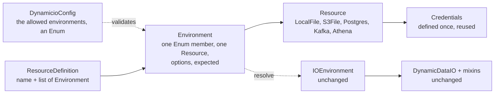

# 0011. Resource definitions as objects

- Status: Proposed (draft PR, for discussion; nothing is implemented)
- Date: 2026-11-18
- Scope: `dynamicio.resources` (new), one branch in `core.py`, a small change in `testharness`
- Release: additive, a minor version; YAML and `IOConfig` stay as they are

## Context

A resource definition says where a dataset lives in each environment. Today it is a YAML file that `IOConfig` parses into an
`IOEnvironment`, and a pipeline reaches it with a string: `config.get(source_key="FOO")`. We keep YAML because a definition is about
orchestration, not logic: it is data that can be reviewed and changed without reading code, and it lists every environment side by side.

The cost shows in day-to-day use:

- **No click-through.** From a runner you cannot jump to the definition of `"FOO"`, and a typo in the key fails only when the task runs.
- **Two hops.** A value such as `"[[ DEV_S3_INPUT_BUCKET ]]"` is a string resolved by a regex loader against `config/environment.py`, so finding it is a text search.
- **Repetition.** Every environment block repeats the whole Postgres connection (`db_host`, `db_port`, `db_name`, `db_user`, `db_password`),
  and the only reuse tool is a YAML anchor (`&name`, `<<: *name`).
- **Free-form environment names.** Nothing stops one file from naming `STAGING` where the rest of the project says `DEV`; the mistake shows up at run time.

## Decision

Add a second, typed way to declare the same thing, without replacing the first. Each part of a YAML resource definition becomes an object
with the same 1:1 shape, and the result is the **same `IOEnvironment`** that `IOConfig` builds, so readers, writers and mixins do not change.

- `ResourceDefinition(name, [Environment, ...])`: a dataset and its list of environments.
- `Environment(Env.DEV, resource, options=..., expected=...)`: one member of a user-defined `Enum` bound to exactly one `Resource`.
  `expected` stays here, next to the environment, because that is where the test harness (ADR 0006) reads it.
- `Resource` subclasses (`LocalFile`, `S3File`, `Postgres`, `Kafka`, ...): where the data lives, one per backend.
- Reusable connection objects such as `PostgresCredentials`, defined once in `config/environment.py` and shared across datasets and
  environments. A `Postgres` resource takes the credentials plus a `table` or a `query`.
- `DynamicioConfig`, registered once with `configure(...)`: the allowed environments (an `Enum`) and the active one. A definition may use
  some of them, never one that is not in the enum.

The rest of this document sketches the design and the code it would produce.

## Alternatives considered

- **Keep YAML only and add tooling** (generated key stubs, a JSON Schema for editors, a command that prints a resolved binding). It
  needs no new API and could ship first, but it leaves the repetition and the free-form environment names, and a stub is a copy that can drift.
- **Resources that own their reads and writes**, as the unmerged `origin/v5` branch did. That couples "where" to "how" and replaces the
  environment matrix with one location per process. This proposal keeps I/O in `DynamicDataIO` and the mixins.
- **A catalog class that groups definitions** (a code version of one YAML file). Rejected as redundant: a module-level variable is
  already something to click through to, and a container adds a second thing to learn.
- **Replace YAML.** Rejected for now: it would be a second major break after the schema change of 11.0.0, and downstream pipelines
  upgrade by a version bump only. Whether YAML is ever retired is a later decision, made from adoption.

## Consequences

- Click-through, completion, rename and find-usages work on definitions, connections and environments.
- A wrong environment, a duplicate or a wrong field fails at import, not during a run.
- No change to what a read or write does: the same `IOEnvironment` reaches the mixins, which the parity test below pins.
- Two ways to define resources must be documented and tested until YAML is retired, if it ever is.
- Reading definitions without importing user code is no longer always possible. A `dynamicio resources export` command (JSON) is proposed for CI and external tools.

## Design sketch

### 1. Idea in one screen

Everything the YAML says becomes an object, with the same 1:1 shape:



| Object | Role | YAML equivalent |
|---|---|---|
| `DynamicioConfig` | The allowed environments (an `Enum` the user defines), and which one is active. Defined once, shared by every application | Nothing: any name is accepted today |
| `ResourceDefinition` | A dataset: a name and a list of `Environment`s | A top-level key such as `FOO:` |
| `Environment` | One enum member bound to exactly one `Resource`, plus `options` and `expected` | A `LOCAL:` / `DEV:` / `PROD:` block |
| `Resource` subclasses | *What* is read: a location, built from reusable connection objects | `type:` and the `s3:` / `postgres:` / `kafka:` section |
| `PostgresCredentials` (and kin) | *How to connect*: defined once in `config/environment.py`, imported everywhere | Repeated `db_host`, `db_port`... in every block |

No catalog or container class: a definition is a module-level variable, so `FOO` is something you click through to.

### 2. What it looks like

#### 2.1 `config/environment.py`: environments and connections, defined once

```python
# demo/src/config/environment.py
import os
from enum import Enum

from dynamicio.resources import DynamicioConfig, PostgresCredentials, configure


class Env(str, Enum):
    """The only environments a resource definition may name."""

    LOCAL = "LOCAL"
    DEV = "DEV"
    PROD = "PROD"


configure(DynamicioConfig(environments=Env, variable="ENVIRONMENT", default=Env.LOCAL))

TEST_RESOURCES = "demo/tests"
DEV_S3_INPUT_BUCKET = "dev-input"
PROD_S3_INPUT_BUCKET = "prod-input"

DEV_DB = PostgresCredentials(host=os.getenv("DEV_DB_HOST"), port=5432, database="app", user=os.getenv("DB_USER"), password=os.getenv("DB_PASS"))
PROD_DB = DEV_DB.replace(host=os.getenv("PROD_DB_HOST"))
```

#### 2.2 The definitions

```python
# demo/src/resources/definitions/staging_input.py
from dynamicio.resources import Environment, LocalFile, Postgres, ResourceDefinition, S3File

from demo.src.config.environment import DEV_DB, DEV_S3_INPUT_BUCKET, PROD_DB, PROD_S3_INPUT_BUCKET, TEST_RESOURCES, Env

FOO = ResourceDefinition(
    "FOO",
    [
        Environment(Env.LOCAL, LocalFile(f"{TEST_RESOURCES}/data/input/foo.csv", "csv")),
        Environment(Env.DEV, S3File(DEV_S3_INPUT_BUCKET, "data/foo.h5", "hdf")),
        Environment(Env.PROD, S3File(PROD_S3_INPUT_BUCKET, "data/foo.h5", "hdf")),
    ],
)

BAR = ResourceDefinition(
    "BAR",
    [
        Environment(Env.LOCAL, LocalFile(f"{TEST_RESOURCES}/data/input/bar.parquet", "parquet")),
        Environment(Env.DEV, Postgres(DEV_DB, table="bar")),
        Environment(Env.PROD, Postgres(PROD_DB, table="bar")),
    ],
)

# The same credentials, a different question: the connection is reused, only the query changes.
BAR_SUMMARY = ResourceDefinition(
    "BAR_SUMMARY",
    [
        Environment(Env.LOCAL, LocalFile(f"{TEST_RESOURCES}/data/input/bar_summary.parquet", "parquet")),
        Environment(Env.DEV, Postgres(DEV_DB, query="SELECT id, count(*) AS n FROM bar GROUP BY id")),
        Environment(Env.PROD, Postgres(PROD_DB, query="SELECT id, count(*) AS n FROM bar GROUP BY id")),
    ],
)
```

An output that the test harness checks declares `expected` on the environment it belongs to:

```python
STAGED_FOO = ResourceDefinition(
    "STAGED_FOO",
    [
        Environment(
            Env.LOCAL,
            LocalFile(f"{TEST_RESOURCES}/data/raw/staged_foo.parquet", "parquet"),
            expected=Expected(f"{TEST_RESOURCES}/data/raw/expected/staged_foo.parquet"),
        ),
        Environment(Env.DEV, S3File(DEV_S3_OUTPUT_BUCKET, "live/data/raw/staged_foo.parquet", "parquet")),
    ],
)
```

The "no extras, not all required" rule: `STAGED_FOO` has no `PROD` and that is fine; naming an environment that is not in `Env` is an error.

```python
>>> Environment("STAGING", LocalFile("x.csv", "csv"))
UnknownEnvironmentError: 'STAGING' is not an environment of this project. Allowed: LOCAL, DEV, PROD.
```

#### 2.3 The runner

```python
from demo.src.resources.definitions.staging_input import FOO     # ctrl-click goes to the definition

foo_df = InputIO(source_config=FOO, schema=Foo).read()
```

### 3. Design

#### 3.1 `DynamicioConfig`: one configuration object for every definition

An application, or a package shared by several applications, builds one `DynamicioConfig` and registers it with `configure()`. Every
`Environment` is checked against its `environments` enum when it is built, so a bad name fails at import. Because definitions
import `config/environment.py` (for their values), the configuration is always registered before the first definition is built.

```python
# dynamicio/resources/dynamicio_config.py
class DynamicioConfig:
    """What every resource definition of a project has in common."""

    def __init__(self, environments: Type[Enum], variable: Optional[str] = None, default: Optional[Enum] = None):
        """
        Args:
            environments: The enum of allowed environments. The first member is the default of the testing tools.
            variable: The process variable that selects the active environment, e.g. ``ENVIRONMENT``.
            default: The active environment when `variable` is unset. Defaults to the first member.
        """

    def check(self, name: Union[str, Enum]) -> Enum:
        """The enum member for `name` (a member or its value), otherwise raise UnknownEnvironmentError."""

    @property
    def active(self) -> Enum:
        """The `use()` override, else the member named by `variable`, else `default`."""

    @contextmanager
    def use(self, environment: Enum) -> Iterator[None]:
        """Select `environment` inside the block. A `ContextVar`, so threads and asyncio tasks do not leak into each other."""
```

`configure(config)` stores it process-wide (like the dynamic-vars module today). Building an `Environment` before `configure()` raises
`DynamicioNotConfiguredError` with the line to add. To share the environments across applications, put `Env` and the `configure(...)`
call in a package that each application imports; dynamicio only provides the object.

#### 3.2 `Environment`

```python
# dynamicio/resources/environment.py
class Environment(BaseModel):
    """One environment of a dataset: an enum member and exactly one resource."""

    name: Enum
    resource: Resource
    options: Mapping[str, Any] = Field(default_factory=dict)   # reader or writer options, the same keys as `options:` in YAML
    expected: Optional[Expected] = None                        # the reference file dynamicio.testharness compares an output with

    def to_io_environment(self) -> IOEnvironment:
        """The object the mixins already consume."""
```

`expected` is here, not on `Resource`: it says how a test treats the output **in that environment**, which is where the YAML and ADR 0006
put it. Reading and writing ignore it, as today. `options` stays beside it for the same reason as in the YAML.

#### 3.3 `Resource`, and connections that are defined once

A `Resource` says *what* is read. Where several fields describe a connection, they live in a **reusable, frozen connection object** that
the resource takes, so the connection is declared once and only the addressing (table, query, path, topic) changes.

```python
# dynamicio/resources/postgres_credentials.py
class PostgresCredentials(BaseModel):
    """How to connect to one Postgres database. Frozen, so it is safe to share."""

    host: str
    port: int = 5432
    database: str
    user: str
    password: SecretStr          # not printed in a repr, a log line or a traceback

    class Config:
        frozen = True

    def replace(self, **changes: Any) -> "PostgresCredentials":
        """A copy with some fields changed: this is what a YAML anchor and `<<: *name` did."""
```

```python
# dynamicio/resources/postgres.py
class Postgres(Resource):
    """A Postgres table or query behind one set of credentials."""

    credentials: PostgresCredentials
    table: Optional[str] = None      # checked against the model's `__table_name__`, see question 3
    query: Optional[str] = None      # becomes the `sql_query` option, the mechanism that exists today

    @root_validator
    def _table_or_query(cls, values):
        """At most one of `table` and `query`."""
```

Single-value connections (a bucket name, a Kafka server) stay plain strings: an object per string is noise. The rule is "an object
where there are several fields, or where a secret is involved".

```python
class S3File(Resource, S3DataSubSection):      # bucket, file_path, file_type: positional, in that order
class S3PathPrefix(Resource, S3PathPrefixSubSection)
class LocalFile(Resource, LocalDataSubSection)  # file_path, file_type
class LocalBatch(Resource, LocalBatchDataSubSection)
class Kafka(Resource, KafkaDataSubSection)      # kafka_server, kafka_topic
class Athena(Resource, AthenaDataSubSection)    # s3_output, database, region_name, workgroup, query
```

The fields that exist in YAML today **inherit the existing pydantic sub-sections**, so their validation (a `path_prefix` ends in `/`,
the legacy bucket split, the Athena `s3_staging_dir` error) is inherited, not rewritten. `Postgres` is the one that composes: its
`credentials` flatten into the `postgres:` section the mixin reads (`db_host`, `db_port`, `db_name`, `db_user`, `db_password`), and `query`
becomes `options["sql_query"]`, so `with_postgres.py` is not touched.

Every resource has a base class with the one thing the environment needs:

```python
class Resource(BaseModel, ABC):
    """Where one dataset lives. Declarative: building it opens nothing."""

    def to_io_environment(self, options: Mapping[str, Any], expected: Optional[Expected]) -> IOEnvironment: ...
```

#### 3.4 `ResourceDefinition`

```python
# dynamicio/resources/resource_definition.py
class ResourceDefinition:
    """One dataset: a name and a list of environments, each bound to one resource."""

    def __init__(self, name: str, environments: Sequence[Environment]):
        """
        Raises:
            DuplicateEnvironmentError: two environments have the same name (the name to resource mapping is 1:1).
            ValueError: the list is empty.
        """

    def resolve(self, environment: Optional[Enum] = None) -> IOEnvironment:
        """The `IOEnvironment` of `environment`, default the active one.

        Raises:
            EnvironmentNotDefinedError: this dataset lists no environment of that name. The message lists the ones it has.
        """

    @classmethod
    def instances(cls) -> List["ResourceDefinition"]:
        """Every definition that is alive (a `WeakSet`, as `IOConfig.instances()` does), so the test harness can find them."""
```

#### 3.5 The one change in `core.py`

```diff
 class DynamicDataIO:
     def __init__(self, source_config: IOEnvironment, ...):
+        if isinstance(source_config, ResourceDefinition):
+            source_config = source_config.resolve()
         self.sources_config = source_config
```

The mixins, `allow_options`, the readers and writers are **not touched**, so the compatibility rules of AGENTS.md hold by construction.

#### 3.6 Test harness

1. **Select an environment.** `ExpectedOutputs(environment=Env.LOCAL)` calls `config.use(...)` for definitions, as it patches every live `IOConfig` today.
2. **Find the outputs that declare `expected`.** `check_all()` keeps those live definitions (`ResourceDefinition.instances()`) whose
   active environment has an `expected`, so a forgotten output cannot go unverified (the reason ADR 0006 chose `check_all`). A list can be
   passed instead: `check_all(STAGED_FOO, FINAL_BAR)`.

I have not read all of `testharness`, so the exact edits are to be confirmed during implementation.

### 4. What this answers

| Concern | Answer |
|---|---|
| Click-through | `FOO`, `DEV_DB` and `Env.DEV` are Python names: go-to-definition, rename, find-usages, completion. |
| Two hops (`get("FOO")`, then `[[ VAR ]]` to `environment.py`) | The value is the imported name. No `[[ ]]` loader. |
| Repetition between environments | A connection object is defined once and reused, across environments and datasets. No YAML anchors. |
| Typos | A wrong environment, a duplicate, or a wrong field fails at import. |
| Same environments everywhere | One `DynamicioConfig` enum; no definition can add an environment of its own, none is forced to have all of them. |
| Secrets in logs | `SecretStr`. |
| Coupling of "where" and "how" | A resource builds the `IOEnvironment` the YAML path builds, and opens nothing. |
| Compatibility | Additive. YAML and `IOConfig` unchanged. |

#### What it does not solve

- **Static tooling needs an import.** Importing user code can have side effects. Mitigation: `dynamicio resources export <module> --format json`
  for CI and external tools; keep definition modules free of heavy imports.
- **Non-Python editors.** Changing a bucket becomes a one-line Python diff.
- **Two ways to define resources** to document and test, until and unless YAML is retired.

### 5. Compatibility and testing (AGENTS.md rules)

1. **Parity test.** For the demo and each backend, build the dataset from YAML and from Python and assert
   `IOConfig(...).get("X") == FOO.resolve(Env.DEV)` (pydantic equality) for every environment. This is the guarantee that I/O is byte-compatible,
   and it covers the flattened Postgres credentials and `query` to `sql_query`.
2. **CLOUD test through the public call.** A Python-defined `S3File` in a cloud environment, with the in-memory object store
   (like `_json_object_store` in `tests/test_mixins/test_s3_mixins.py`), read and written through `IO(source_config=FOO)`.
3. **Errors.** Unknown environment, duplicate environment, undefined environment at `resolve()`, use before `configure()`, `use()` isolation across threads.
4. **No new reader or writer option**, so nothing is added to `utils.allow_options`; `query` reuses the existing `sql_query` option.
5. CHANGELOG under the next minor heading; the README and `docs/guides/resource-definitions.md` get a Python example beside each YAML one.

### 6. Module layout

One class per module, in a package whose `__init__.py` re-exports the public names and explains how the pieces fit.

```text
dynamicio/resources/
├── __init__.py              # re-exports; docstring with the diagram of section 1
├── dynamicio_config.py      # DynamicioConfig (+ configure())
├── environment.py           # Environment
├── expected.py              # Expected
├── resource.py              # Resource (base)
├── resource_definition.py   # ResourceDefinition
├── postgres_credentials.py  # PostgresCredentials
├── postgres.py              # Postgres
├── local_file.py  local_batch.py  s3_file.py  s3_path_prefix.py  kafka.py  athena.py
```

`UnknownEnvironmentError` (`ValueError`), `EnvironmentNotDefinedError` (`KeyError`), `DuplicateEnvironmentError` (`ValueError`) and
`DynamicioNotConfiguredError` (`RuntimeError`) go in `dynamicio/errors.py`.

### 7. Rollout

| Step | Change | Risk |
|---|---|---|
| 1 | `dynamicio.resources` and the `core.py` branch. Nothing existing changes. | Low |
| 2 | `dynamicio resources migrate <definitions.yaml>` writes the Python definitions and lifts repeated Postgres blocks into one `PostgresCredentials`. | Medium: it must round-trip every demo and test definition (the parity test) |
| 3 | Harness accepts definitions; demo and docs show Python first. | Low |
| 4 | Decide on YAML later, from adoption. Only a major release could deprecate it. | Out of scope |

### 8. Open questions for review

1. **Credentials per environment or one object with `.replace`?** The example defines `DEV_DB` and `PROD_DB` as two objects; this reads
   well. If a project's environments differ only by host, `PROD_DB = DEV_DB.replace(host=...)` avoids repeating the rest.
2. **Which other connections deserve an object?** I propose `PostgresCredentials` now; Athena (`s3_output`, `database`, `region_name`,
   `workgroup`) is the next candidate. Kafka and S3 stay plain strings.
3. **`table` against the model's `__table_name__`.** Today the table of a Postgres read or write comes from the Pandera model
   (`core.py` raises `TableNameNotFoundError` without one, unless `sql_query` is set, ADR 0009). Declaring it on the resource too would give
   two sources. Recommendation: `table` is **checked** against the model, and a mismatch fails when the IO object is built; it never overrides.
   The alternative is to leave `table` out and let the model name it, as now.
4. **Global `configure()`.** Process-wide, like the dynamic-vars module. The alternative is passing the config to every
   `ResourceDefinition`, which is explicit but repeats it. Recommendation: global.
5. **Strings are accepted for environment names** (`Environment("DEV", ...)` is coerced to `Env.DEV`) as well as members. Should it be members only?
6. **Is positional `S3File(bucket, path, type)` too terse?** It is lean, but keyword arguments read better in review. Both work.
7. **pydantic 1 and 2.** The existing models use the v1 API under v2. `replace`, `frozen` and `SecretStr` need a small shim for both.
8. **External readers of the YAML.** Is a JSON export enough for them? I did not check which tools read the YAML today.
