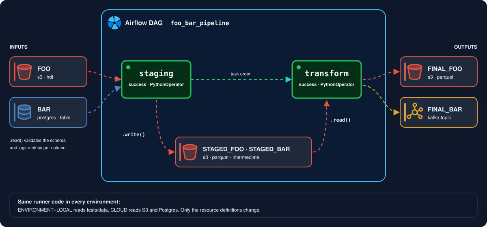

# Pipelines

The [`demo/`](https://github.com/VorTECHsa/dynamicio/tree/master/demo) directory of the repository is a runnable
two-task pipeline (staging, then transform) with its own tests. It reads `foo` from S3 and `bar` from Postgres in
`DEV` and `PROD`, and from sample files in `LOCAL`.

<figure markdown>
  
</figure>

What to copy from it:

- the [recommended project structure](../guides/resource-definitions.md#recommended-project-structure): definitions,
  models and IO classes together under `src/resources`;
- `DEV` and `PROD` definitions that share YAML anchors and override only hosts and buckets;
- an end-to-end test that runs both tasks in `LOCAL` and compares their outputs with reference files, see
  [Testing pipelines locally](../guides/testing-pipelines.md);
- concurrent reads and writes, see [Using asyncio](../guides/asyncio.md).

To run its tests from a checkout:

```shell
uv sync
uv run pytest demo/tests
```

For the reasoning behind larger design choices, such as how S3 is accessed or how schemas are declared, see the
[architecture decisions](../adr/README.md).
