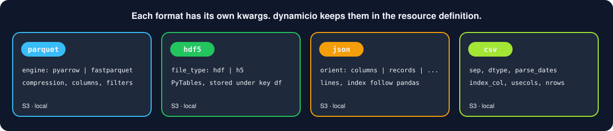
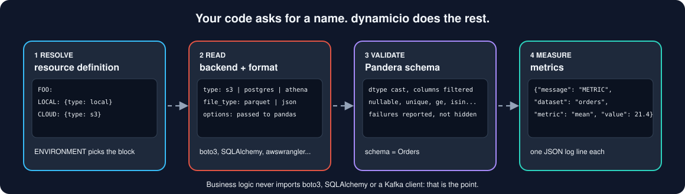

# Concepts

Why dynamicio exists, and the ideas it is built from. The short version is in [Why dynamicio](why-dynamicio.md): business logic
should be independent of I/O, and the seam between them is what makes fast, safe local feedback possible.

Working with `pandas` dataframes has opened up a new world of potential in Data Science. However,
if you are using `pandas` to support production pipelines, whether ML or ETL, you end up having
a big part of your code be concerned with I/O operations. 

## Managing various Resources
First, it's the various type of resources you need to interact with; object storage (S3 or GCS)
databases (Athena, Big Query, Postgres), Kafka and many more. For each of these, you have 
dependencies on various libraries such as `boto3`, `awswrangler`, `SQLAlchemy`,
`tables` (for `hdf5`), `confluent-kafka` and many more. 

## Managing Various Data Types
{ width="900" }

Then it's the various data types you need to handle, `parquet`, `hdf5`, `csv`, `json` and many
others, each of which come with their own set of configuration `kwargs`, things like the 
orientation of the dataset (`json`) or the parquet engine you want 
to use behind the scenes (`pyarrow` or `fastparquet`).

## Validations & Metrics Generation
Then, it's the need to validate your expectations on the datasets; things like unique or
null values being allowed in a column, allowing only a specific set of categorical values, or
numerical values within a specified range. And what about metrics generation? The ability to
monitor data distributions and how various metrics change with every run, is a significant
aspect of monitoring the quality of your solution. 

## Testing (Running Local Regression Tests)
Finally, what about testing your code in different environments? Take, for instance, a traditional
setup where you have the following 4 environments to work against:

- Local;
- Develop;
- Staging, and;
- Production.

Configuring your code to work against the last 3 `Develop, Staging and Production` can easily be done through
environment variables, but what about testing locally? What if you want to run your pipelines locally? 
Well, you can, but usually that entails a big deal of mocking calls to external services. Instead, wouldn't
it be great if you could seamlessly direct your I/O operations to local sample data.

## So, what do we do about these? 
This proliferation of I/O operations leads to the emergence of glue code, which can be very difficult to manage. The problem is highlighted 
as an **ML-System Anti-Pattern** in [Hidden Technical Debt in Machine Learning Systems](https://papers.nips.cc/paper/2015/file/86df7dcfd896fcaf2674f757a2463eba-Paper.pdf)

> ...ML researchers tend to develop general purpose solutions as self-contained packages. A wide variety of these are
> available as open-source packages at places like `ml-oss.org`, or from in-house code, proprietary packages, and cloud-based platforms.
>
> Using generic packages often results in a **glue code** system design pattern, in which a massive amount of supporting
> code is written to get data into and out of general-purpose packages. **Glue code** is costly in the long
> term because it tends to freeze a system to the peculiarities of a specific package; testing alternatives
> may become prohibitively expensive. In this way, using a generic package can inhibit improvements, because it
> makes it harder to take advantage of domain-specific properties or to tweak the objective function to
> achieve a domain-specific goal. Because a mature system might end up being (at most) 5% machine learning
> code and (at least) 95% glue code, it may be less costly to create a clean native solution rather
> than re-use a generic package.

## The Solution

Quoting from the same paper:

> An important strategy for combating glue-code is to wrap black-box packages into common API's. This allows supporting
> infrastructure to be more reusable and reduces the cost of changing packages.

{ width="900" }

Dynamicio (or dynamic(i/o)) serves exactly that; it serves as a convenient wrapper around `pandas` I/O operations. It's a manifestation of 
the dependency inversion principle--a layer of indirection if you want--which keeps your code DRY and increases re-usability, effectively 
decoupling business logic from the I/O layer. That boundary is a *seam*: a place where behaviour changes (a different environment,
a different storage, sample files in a test) without editing the code on either side.

## Main features
`dynamic(i/o)` supports:
* seamless transition between environments; 
* abstracting away from resource and data types through `resource definitions`; 
* honouring your expectations on data through `schema definitions`, declared as [Pandera](https://pandera.readthedocs.io) models;
* metrics auto-generation (logging) for monitoring purposes.

## Worth remembering

The behaviour worth remembering:

- Validation and metrics are off unless the model declares `__io__ = Behaviour(validate=True, log_metrics=True)` or the call passes `apply_schema_validations` / `log_schema_metrics`: without them a schema only selects and casts columns. An argument of the call overrides the model.
- On read, dynamicio casts, then validates, then logs metrics. On write it keeps only the schema's columns, validates, logs metrics, then casts.
- A failed validation raises `dynamicio.errors.SchemaValidationError`; its `.message` is a dict of validation name to details, with every violation collected, not just the first.
- Metrics are emitted as `METRIC` JSON log lines on the `dynamicio.metrics` logger, so they are easy to parse in your log dashboards.
- See the [changelog](../changelog.md) for what changed between releases and the [architecture decisions](../adr/README.md) for the reasoning behind the larger ones.

Please do reach out with comments and your views about how the library or the docs can be improved, and by all means, come along and contribute to our project!
