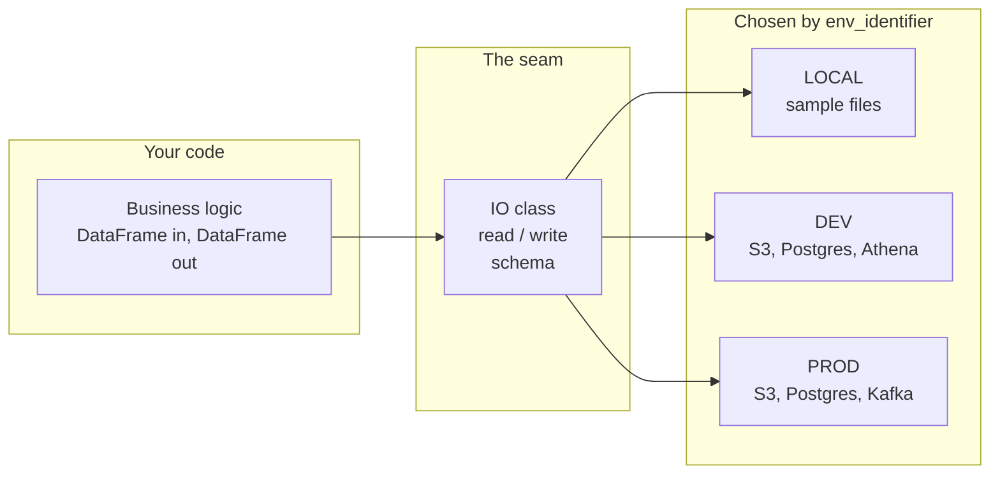

# Why dynamicio

Business logic should not know where its data lives.

A pipeline has two kinds of code. One kind decides things: it joins, filters, scores and aggregates. The other kind moves
bytes: it opens S3 keys, builds SQL connections, picks a parquet engine, and chooses `orient="records"` for a JSON
file. The first kind is what you are paid to get right. The second kind is where the surprises are, and it is easy to
mix the two until you cannot change either without touching the other.

dynamicio puts a **seam** between them.

## The seam

A seam is a place where you can change what a program does without editing the code at that place. In dynamicio the
seam is the `read()` and `write()` of an IO class. Your logic calls them. What they read from, what they write to, and in
which format is not in your logic. It is in a resource definition, per environment.



In code, this is what the business logic looks like when the seam is respected:

```python
def build_report(orders: pd.DataFrame) -> pd.DataFrame:
    """Pure logic: no paths, no clients, no formats."""
    return orders.groupby("customer_id", as_index=False)["amount"].sum()


def run(orders_io: OrdersIO, report_io: ReportIO) -> None:
    report_io.write(build_report(orders_io.read()))
```

`build_report` has no I/O in it, so you can test it with a hand-made dataframe. `run` has no knowledge of storage, so
the same function runs against sample files on a laptop and against S3 in production. Neither one changes when the data
moves from CSV to parquet, from a prefix to a single object, or from `DEV` to `PROD`.

## What developers stop worrying about

- **Where the data is.** A resource definition names it per environment. Moving a dataset is an edit to YAML.
- **How it is stored.** The `pandas`, `pyarrow`, `awswrangler` and `boto3` options for each format live next to the
  location, not scattered through the code. dynamicio passes them through to those libraries, so what you know about
  them still applies.
- **Whether the data is right.** A [Pandera](https://pandera.readthedocs.io) model states columns, dtypes and
  validations once. A bad frame fails at the boundary with every violation listed, not three transformations later.
- **Whether you can see it.** Schema metrics are logged as `METRIC` lines, so distributions are in your logs without
  extra code.
- **Which environment you are in.** One identifier selects it.

## What the seam makes possible: fast feedback

The most useful consequence is not tidiness. It is that the whole pipeline can run somewhere safe.

With a `LOCAL` environment that points at sample files, you run the real tasks in order, on your machine, with no cloud
credentials, no deploy, and no mocks of external services. You then compare what they wrote with expected files using the
[test harness](../guides/testing-pipelines.md). A change gets a pass or a fail in the time it takes to run the
pipeline on sample data, rather than after a deploy and a scheduled run.

That loop is worth having for a person. It is worth more when the one changing the code is an agent.

## Why this matters more with coding agents

An AI coding agent that edits a data pipeline needs three things from the project:

1. **A place to run the code that cannot hurt anything.** `LOCAL` resources read and write sample files. The agent
   never needs production credentials, and a mistaken write goes to a scratch directory.
2. **A check that says whether the change was right.** Expected outputs and schema validation give a verdict the agent
   can read: the harness collects every mismatch and raises one `OutputMismatchError` that lists them all, instead of
   leaving the agent to guess what the data should look like.
3. **Code that is small enough to reason about.** When logic is separate from I/O, a change to a calculation does not
   require understanding connection handling, and a change to a storage location does not require reading the
   calculation.

None of this is specific to agents. These are the properties that make any change safer, and a human reviewer gets
the same benefits. But an agent can run a local pipeline many times without tiring, and it can only do so safely if a
local pipeline exists. The seam is what makes one possible. dynamicio does not make an agent better at writing
pipelines. It gives the agent, and you, a loop in which the result of each change is checked.

## What dynamicio does not do

- It does not transform data. Your logic does that, with `pandas`.
- It does not hide `pandas`. Options in the YAML go to the reader or writer, and what a frame looks like after a read is
  what `pandas` and your schema say.
- It does not support dataframe engines other than `pandas`. Polars is not supported.
- It is not a workflow scheduler. It runs inside the tasks that a scheduler calls.

## Where next

- [Quickstart](quickstart.md): the seam end to end, with no cloud account.
- [Concepts](concepts.md): the problem of glue code, and how the pieces fit.
- [Testing pipelines locally](../guides/testing-pipelines.md): run a pipeline on sample files and check its outputs.
