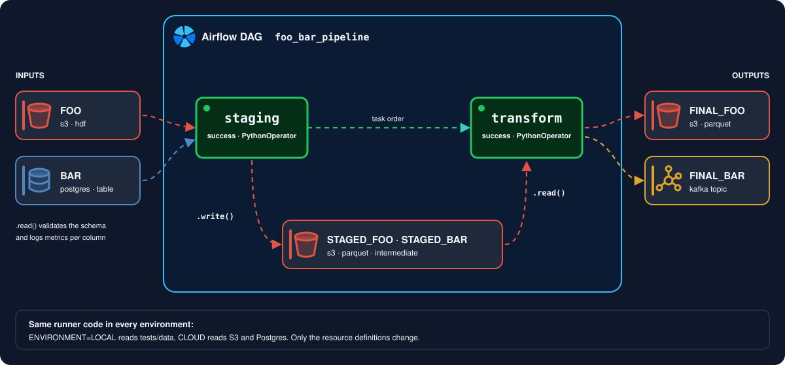

# Resource definitions

We will go over an end-to-end example for reading and writing a single dataset, covering:

1. all components involved and how they are configured, and;
2. how these components are pieced together

You can find this example under the demo directory of this repo.

## Keywords:

- **resource definitions**: the YAML files that say *where* each dataset lives (path, bucket, table, topic...) for each environment.
- **source configs**: what `IOConfig` parses a resource definition into, one per dataset; you hand one to an IO class to read or write that dataset.
- **schema definitions**: the Python classes (Pandera models, see Step 4.1) that say *what* a dataset looks like: columns, dtypes, validations and metrics.
  Older projects may still declare them in YAML or as plain dictionaries; both keep working.

## Let's start

Suppose you want to ingest the `foo` and `bar` datasets, respectively from `S3` and `Postgres` and stage them
to S3 for further processing.

Assume you want to build a pipeline that looks something like the image below:

{ width="900" }

Assume the below repository structure, which implements this pipeline, for the purpose of this tutorial. It is also the
structure we recommend for a data pipeline repository (see [Recommended project structure](#recommended-project-structure) below):

```shell
demo
├── __init__.py
├── src
│   ├── __init__.py
│   ├── __main__.py
│   ├── config
│   │   ├── __init__.py
│   │   ├── constants.py
│   │   └── environment.py
│   ├── resources
│   │   ├── __init__.py
│   │   ├── definitions
│   │   │   ├── staging_input.yaml
│   │   │   ├── staging_output.yaml
│   │   │   ├── transform_input.yaml
│   │   │   └── transform_output.yaml
│   │   ├── io.py
│   │   └── schemas
│   │       ├── __init__.py
│   │       ├── input.py
│   │       └── processed.py
│   └── runners
│       ├── __init__.py
│       ├── staging.py
│       ├── transform.py
│       └── utils
│           ├── __init__.py
│           └── runner_selection.py
└── tests
    ├── __init__.py
    ├── config
    │   ├── __init__.py
    │   └── constants.py
    ├── data
    │   ├── input
    │   │   ├── bar.parquet
    │   │   └── foo.csv
    │   ├── processed
    │   │   └── expected
    │   │       ├── final_bar.parquet
    │   │       └── final_foo.parquet
    │   └── raw
    │       └── expected
    │           ├── staged_bar.parquet
    │           └── staged_foo.parquet
    ├── resources
    │   ├── __init__.py
    │   └── test_prefix_schema_evolution.py
    ├── runners
    │   ├── __init__.py
    │   ├── conftest.py
    │   ├── test_staging.py
    │   ├── test_transform.py
    │   └── utils
    │       ├── __init__.py
    │       └── test_runner_selection.py
    └── test_pipeline.py
```

#### Recommended project structure

Everything that describes *what data the pipeline touches* lives together under `src/resources`; everything that describes
*what the pipeline does with it* lives outside:

| Path | Holds |
|---|---|
| `src/resources/definitions/*.yaml` | Resource definitions: where each dataset lives per environment, its format and options. YAML, so a bucket or path can change without touching code |
| `src/resources/schemas/*.py` | The datasets' Pandera models: columns, dtypes, validations, metrics. One module per definitions file (`input.py` next to `definitions/staging_input.yaml`), or per runner and direction in a bigger pipeline (`stage.py`, `transform.py`, ...) |
| `src/resources/io.py` | The `UnifiedIO`/`DynamicDataIO` subclasses used to read and write them |
| `src/config/environment.py` | The values behind the `[[ DYNAMIC ]]` variables in the definitions, and the `RESOURCES` path |
| `src/config/constants.py` | Constants shared by the runners, e.g. writer options |
| `src/runners/` | The pipeline steps: they import from `src.resources` and never open a file or table directly |
| `tests/` | Tests mirror the `src/` tree (`tests/runners/test_staging.py` tests `src/runners/staging.py`, and so on), plus `tests/test_pipeline.py` for the end-to-end run, and the sample data under `tests/data` (the `LOCAL` environment points at it) |

Rules of thumb: a dataset is added by touching `src/resources` only (definition, model, optionally an IO class); a runner
changes only when its logic changes. Keep the models next to the definitions that use them so a resource and its contract
are reviewed together. `demo/` follows this structure.

### Step 1: Resource Definitions

We will start with defining our input and output resources as yaml files. These need to be defined under `src/resources/definitions`:

```shell
resources
└── definitions
    ├── staging_input.yaml
    ├── staging_output.yaml
    ├── transform_input.yaml
    └── transform_output.yaml
```

The recommended structure is one input and one output definition per runner, as above and in `demo/`. Each resource lists its environments (`LOCAL`, `DEV`
and `PROD` in the demo), **the local one first**: the first environment listed is the default of the testing tools (see [Choosing the environment](testing-pipelines.md#choosing-the-environment)).
Environment names are yours to choose: they are only the keys you select with `env_identifier`.

The definitions are plain YAML, so repetition can be removed with anchors: `&name` marks a block, `*name` reuses it, and `<<: *name` merges it with the keys
written next to it taking precedence. In the demo, `PROD` reuses `DEV`'s `s3`, `postgres` and `kafka` blocks and Kafka `options`, overriding only the host or bucket.

Schemas are not part of the resource definitions: they are declared as Pandera models in the `src/resources/schemas/` package, one module per group of datasets (see Step 4.1).

You will need to define your pipeline's resources by creating four `yaml` files, the ones in `demo/src/resources/definitions`. The first is:

- `staging_input.yaml`, which concerns data read by the **staging** task:

```yaml
---
# `&name` anchors a block and `*name` reuses it; `<<: *name` merges it, and keys written next to it override. DEV and PROD only differ by their hosts.
FOO:
  LOCAL:
    type: "local"
    local:
      file_path: "[[ TEST_RESOURCES ]]/data/input/foo.csv"
      file_type: "csv"
  DEV:
    type: "s3"
    s3: &foo_s3
      bucket: "[[ DEV_S3_INPUT_BUCKET ]]"
      file_path: "data/foo.h5"
      file_type: "hdf"
  PROD:
    type: "s3"
    s3:
      <<: *foo_s3
      bucket: "[[ PROD_S3_INPUT_BUCKET ]]"

BAR:
  LOCAL:
    type: "local"
    local:
      file_path: "[[ TEST_RESOURCES ]]/data/input/bar.parquet"
      file_type: "parquet"
  DEV:
    type: "postgres"
    postgres: &bar_postgres
      db_host: "[[ DEV_DB_HOST ]]"
      db_port: "[[ DB_PORT ]]"
      db_name: "[[ DB_NAME ]]"
      db_user: "[[ DB_USER ]]"
      db_password: "[[ DB_PASS ]]"
  PROD:
    type: "postgres"
    postgres:
      <<: *bar_postgres
      db_host: "[[ PROD_DB_HOST ]]"

ORDERS:
  LOCAL:
    type: "local_batch"
    local:
      path_prefix: "[[ TEST_RESOURCES ]]/data/input/orders/"
      file_type: "parquet"
  DEV:
    type: "s3_path_prefix"
    s3: &orders_s3
      bucket: "[[ DEV_S3_INPUT_BUCKET ]]"
      path_prefix: "data/orders/"
      file_type: "parquet"
  PROD:
    type: "s3_path_prefix"
    s3:
      <<: *orders_s3
      bucket: "[[ PROD_S3_INPUT_BUCKET ]]"
```

- `staging_output.yaml`, which concerns data written by the **staging** task and read by the **transform** task. Its `LOCAL` environments declare an
  `expected` path, the reference file a test compares the generated output with (see [Declaring the expected output](testing-pipelines.md#declaring-the-expected-output)):

```yaml
---
STAGED_FOO:
  LOCAL:
    type: "local"
    local:
      file_path: "[[ TEST_RESOURCES ]]/data/raw/staged_foo.parquet"
      file_type: "parquet"
    expected:
      path: "[[ TEST_RESOURCES ]]/data/raw/expected/staged_foo.parquet"
  DEV:
    type: "s3"
    s3: &foo_s3
      bucket: "[[ DEV_S3_OUTPUT_BUCKET ]]"
      file_path: "live/data/raw/staged_foo.parquet"
      file_type: "parquet"
  PROD:
    type: "s3"
    s3:
      <<: *foo_s3
      bucket: "[[ PROD_S3_OUTPUT_BUCKET ]]"

STAGED_BAR:
  LOCAL:
    type: "local"
    local:
      file_path: "[[ TEST_RESOURCES ]]/data/raw/staged_bar.parquet"
      file_type: "parquet"
    expected:
      path: "[[ TEST_RESOURCES ]]/data/raw/expected/staged_bar.parquet"
  DEV:
    type: "s3"
    s3: &bar_s3
      bucket: "[[ DEV_S3_OUTPUT_BUCKET ]]"
      file_path: "live/data/raw/staged_bar.parquet"
      file_type: "parquet"
  PROD:
    type: "s3"
    s3:
      <<: *bar_s3
      bucket: "[[ PROD_S3_OUTPUT_BUCKET ]]"
```

- `transform_input.yaml`, which concerns the data the **transform** task reads (the staged data):

```yaml
---
STAGED_FOO:
  LOCAL:
    type: "local"
    local:
      file_path: "[[ TEST_RESOURCES ]]/data/raw/staged_foo.parquet"
      file_type: "parquet"
  DEV:
    type: "s3"
    s3: &foo_s3
      bucket: "[[ DEV_S3_OUTPUT_BUCKET ]]"
      file_path: "live/data/raw/staged_foo.parquet"
      file_type: "parquet"
  PROD:
    type: "s3"
    s3:
      <<: *foo_s3
      bucket: "[[ PROD_S3_OUTPUT_BUCKET ]]"

STAGED_BAR:
  LOCAL:
    type: "local"
    local:
      file_path: "[[ TEST_RESOURCES ]]/data/raw/staged_bar.parquet"
      file_type: "parquet"
  DEV:
    type: "s3"
    s3: &bar_s3
      bucket: "[[ DEV_S3_OUTPUT_BUCKET ]]"
      file_path: "live/data/raw/staged_bar.parquet"
      file_type: "parquet"
  PROD:
    type: "s3"
    s3:
      <<: *bar_s3
      bucket: "[[ PROD_S3_OUTPUT_BUCKET ]]"
```

- and `transform_output.yaml`, which concerns data written by the **transform** task:

```yaml
---
FINAL_FOO:
  LOCAL:
    type: "local"
    local:
      file_path: "[[ TEST_RESOURCES ]]/data/processed/final_foo.parquet"
      file_type: "parquet"
    expected:
      path: "[[ TEST_RESOURCES ]]/data/processed/expected/final_foo.parquet"
  DEV:
    type: "s3"
    s3: &foo_s3
      bucket: "[[ DEV_S3_OUTPUT_BUCKET ]]"
      file_path: "live/data/processed/final_foo.parquet"
      file_type: "parquet"
  PROD:
    type: "s3"
    s3:
      <<: *foo_s3
      bucket: "[[ PROD_S3_OUTPUT_BUCKET ]]"

FINAL_BAR:
  LOCAL:
    type: "local"
    local:
      file_path: "[[ TEST_RESOURCES ]]/data/processed/final_bar.parquet"
      file_type: "parquet"
    options:
      use_deprecated_int96_timestamps: true
      coerce_timestamps: "ms"
      allow_truncated_timestamps: false
      row_group_size: 1000000
    expected:
      path: "[[ TEST_RESOURCES ]]/data/processed/expected/final_bar.parquet"
  DEV:
    type: "kafka"
    kafka: &bar_kafka
      kafka_server: "[[ DEV_KAFKA_BROKER ]]"
      kafka_topic: "[[ KAFKA_TOPIC ]]"
    options: &bar_kafka_options
      compression_type: "snappy"
      max_in_flight_requests_per_connection: 10
      batch_size: 262144
      request_timeout_ms: 60000 # 60s
      buffer_memory: 134217728  # 128MB
  PROD:
    type: "kafka"
    kafka:
      <<: *bar_kafka
      kafka_server: "[[ PROD_KAFKA_BROKER ]]"
    options: *bar_kafka_options
```

We will hence refer to these files as **"resource definitions"**.

Each runner has an input and an output definition: `staging_input.yaml` defines the sources of the **staging** task, handled by the respective module
(`runners/staging.py`), `staging_output.yaml` what it writes; similarly for **transform**. These files are parsed by `dynamicio.config.IOConfig` to generate
configuration i/o instances referred to as "source configs" (see `demo/src/__init__.py`).

Notice that under every source there are one layer per environment: `LOCAL`, `DEV` and `PROD`. They point to the variants of the same
dataset, depending on whether it is called from the local environment or from the cloud (we will showcase how this
distinction takes place later).

#### Optional sources: `missing_ok`

Some sources do not exist on every run, for example the state that a previous run writes, before the first run. Pass
`missing_ok=True` to the constructor of the IO class to read such a source:

```python
state_df = PreviousRunStateIO(source_config=input_config.get(source_key="PREVIOUS_RUN_STATE"), missing_ok=True).read()
```

When the source does not exist, `read()` and `async_read()` return `None` and log a warning. "Does not exist" means
that the reader raised a `FileNotFoundError`. This includes a missing local file, a missing S3 csv or json key
(`dynamicio.errors.ObjectNotFoundError`) and an S3 path prefix with no objects (`dynamicio.errors.NoObjectsFoundError`).
A missing S3 parquet or hdf key raises a botocore `ClientError`, so `missing_ok` does not cover it. All other errors,
for example a denied access, raise as before. The default is `False`. The caller handles the `None`, so the argument
is in the code of the caller and not in the resource definition.

Resource definitions say nothing about the *shape* of the data. That is the job of the **"schema definition"** of your dataset, a Python
class kept next to them in a module of `src/resources/schemas/` (we will cover this in detail in Step 4).
