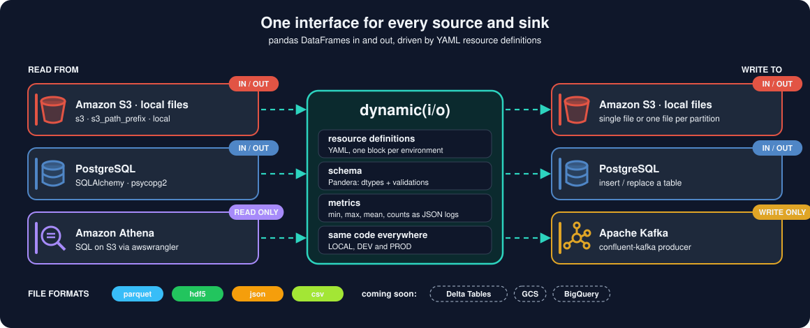

# Supported sources and formats

{ width="900" }

- **S3** (or local) Input & Output, for single files (`type: s3`) and for prefixes holding many files (`type: s3_path_prefix`):
  - `parquet`
  - `h5`
  - `json`
  - `csv`
- **Postgres** Input & Output
- **Athena** Input only (`type: athena`)
- **Kafka** Output

## S3 I/O

S3 is accessed directly through `boto3`, with one client shared per process (safe across forked workers):

* **Single files** (`type: s3`): parquet is read with one `GetObject` and parsed in memory, and written with one
  `PutObject` (multipart above 16 MiB), using the same `pandas`/`pyarrow` options as local I/O. `awswrangler` is only
  used when you pass an option that only it supports, and for `csv`/`json`.
* **Prefixes** (`type: s3_path_prefix`): objects are listed and fetched by a pool of 32 threads, one request per object.
  Parquet objects are parsed in memory as they arrive, so parsing overlaps the download. `no_disk_space: true` is still
  accepted.
* **No `awscli` or `s3fs`**: they are no longer dependencies, so installing `dynamicio` no longer puts an `aws` command
  in your environment. Credentials come from the usual `boto3` chain (environment, profile, IAM role).

Historical v8.1.0 benchmarks measured single-file reads about 2.4x faster and writes about 1.3x faster than the
pre-v8.1.0 implementation. Prefix transfers were broadly on par at equal worker counts; results depend on the workload
([evidence](https://github.com/VorTECHsa/dynamicio/blob/master/docs/adr/0007-s3-io-performance-evidence.md),
[design decision](https://github.com/VorTECHsa/dynamicio/blob/master/docs/adr/0001-direct-boto3-s3-io.md)).

### Parquet prefixes that changed schema over time

Prefixes accumulate objects over the years, so older objects may lack columns that were added to the schema later.
When reading a parquet `s3_path_prefix`, such objects are read with the columns they do have and the missing columns
are filled with nulls; a warning lists each column and how many objects lacked it:

```text
[s3] Some objects under s3://bucket/live/state/ lack columns that are filled with nulls: {'status': 2} (objects lacking each column)
```

This tolerance is deliberate and bounded: a column that is missing from *every* object raises a `ValueError`, and a
schema column typed as a non-nullable dtype (e.g. `int64`) still fails, because nulls cannot be represented. Single-file
reads and `local_batch` are strict. Watch the warning if the missing data would indicate a real upstream problem rather
than an old schema ([design decision](https://github.com/VorTECHsa/dynamicio/blob/master/docs/adr/0002-tolerate-missing-columns-in-parquet-prefix-reads.md)).

## Athena I/O

`type: athena` resources run a SQL query on AWS Athena and return the result as a dataframe, through
[AWS SDK for pandas](https://aws-sdk-pandas.readthedocs.io/) (`awswrangler`). Mix `WithAthena` into your IO class, as with the other sources.
Athena is read-only: writing raises `NotImplementedError`.

```yaml
EVENTS_ATHENA:
  CLOUD:
    type: athena
    athena:
      s3_output: s3://my-athena-results-bucket/dynamicio/   # required: where Athena writes query results
      database: analytics        # optional, default "default"
      workgroup: primary         # optional
      region_name: eu-west-1     # optional: builds a dedicated boto3 session for that region
      query: SELECT id, ts FROM events WHERE day = '2024-01-01'   # optional here, or pass `query=` when instantiating the IO class
```

Notes:

* The query comes from the resource definition or from `query=...` at instantiation; the latter wins, as do any other
  options, which are passed to `awswrangler.athena.read_sql_query` (unknown ones are dropped). A read without a query raises `ValueError`.
* Credentials and region come from the usual `boto3` chain and the process-wide shared session, unless `region_name` is set.
* `ctas_approach` defaults to `False`: the query runs as is and column names keep the case used in the `SELECT`. Pass
  `ctas_approach=True` to use awswrangler's CTAS path (faster for large results, but it creates a temporary Glue table
  and lower-cases column names).
* awswrangler returns nullable pandas dtypes (`Int64`, `string`, `boolean`) and Python `date` objects for `date`
  columns. When the resource declares a schema, dynamicio casts to the declared dtypes, so declare them.
* **Breaking (9.0):** the `s3_staging_dir` key from the PyAthena era was removed. Rename it to `s3_output` (same
  value); a definition that still has it fails to load with an error saying so.

## Coming soon
- **Delta Tables** (pending)
- **GCS** (pending)
