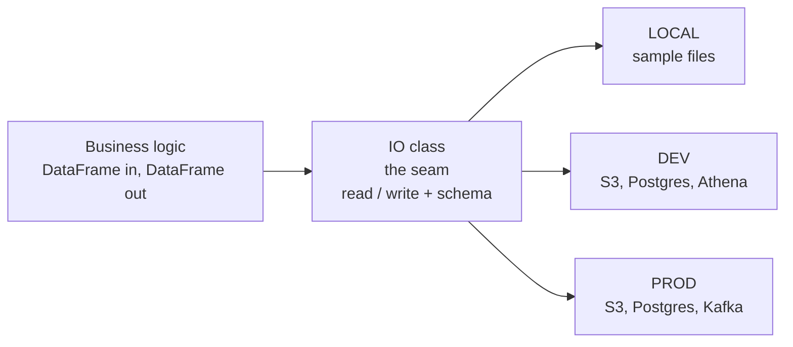

<div class="dynamicio-hero" markdown>
{ width="420" } { width="100" }
</div>

# dynamicio

**Keep business logic independent of I/O.** dynamicio is the seam between your `pandas` code and the places your data
lives. Declare *where* a dataset is in YAML, declare *what* it looks like as a [Pandera](https://pandera.readthedocs.io)
model, and your code calls `read()` and `write()`. The same code then runs on a laptop against sample files and in
production against S3, PostgreSQL, Athena or Kafka.

!!! note "pandas only"
    Dataframe execution supports `pandas`. Polars is not supported.

## The point

Developers should not have to think about connection strings, parquet engines, JSON orientations or which bucket a task
reads this week. That code is not the logic they are paid to get right, and when it is mixed in with the logic, neither
can change without the other.



Switching `LOCAL` to `DEV` to `PROD` is a change of one identifier, not of code. Read [Why dynamicio](getting-started/why-dynamicio.md)
for the full argument.

## What you get

- **Logic that does not know about storage.** One call site per dataset, whatever the storage or format.
- **Fast, safe feedback.** Run the whole pipeline locally on sample files, with no credentials and no mocks of external
  services, then check the outputs against [expected files](guides/testing-pipelines.md).
- **A loop that suits coding agents.** An agent that changes a pipeline needs a place to run it that cannot hurt
  production, and a check that says whether the change was right. A `LOCAL` environment and the test harness provide both.
- **Data contracts.** Columns, dtypes, validations and metrics live in one reviewed Pandera model. A bad frame fails at
  the boundary with every violation listed.
- **Environments as configuration.** The same task runs locally, in development and in production.
- **Metrics in your logs.** Distributions are logged as `METRIC` JSON lines.

## Supported sources and destinations

| Source | Read | Write | Formats |
|---|---|---|---|
| Local files (`local`, `local_batch`) | yes | yes | `parquet`, `hdf`, `json`, `csv` |
| S3 object (`s3`) and prefix (`s3_path_prefix`) | yes | yes | `parquet`, `hdf`, `json`, `csv` |
| PostgreSQL | yes | yes | tables |
| AWS Athena | yes | no | SQL query results |
| Kafka | no | yes | messages |

Details are in [Supported sources and formats](guides/sources-and-formats.md).

## Install

```shell
pip install dynamicio
# or, in a uv project
uv add dynamicio
```

Python 3.10 to 3.14 is supported. See [Installation](getting-started/installation.md).

## A minimal example

The [quickstart](getting-started/quickstart.md) builds this end to end and runs without any cloud credentials:

```python
from dynamicio import UnifiedIO
from dynamicio.config import IOConfig


class OrdersIO(UnifiedIO):
    schema = Orders  # a pandera.DataFrameModel


config = IOConfig("orders.yaml", env_identifier="LOCAL", dynamic_vars=Settings)
orders = OrdersIO(source_config=config.get(source_key="ORDERS"), apply_schema_validations=True)

orders.write(df)
df = orders.read()
```

## Where next

- [Why dynamicio](getting-started/why-dynamicio.md), [Quickstart](getting-started/quickstart.md) and [Concepts](getting-started/concepts.md)
- Guides: [reading](guides/reading-data.md), [writing](guides/writing-data.md),
  [schemas and validation](guides/schemas-and-validation.md), [error handling](guides/error-handling.md)
- [API reference](reference/index.md)
- [Changelog](changelog.md), [source code](https://github.com/VorTECHsa/dynamicio),
  [PyPI](https://pypi.org/project/dynamicio/), [issues](https://github.com/VorTECHsa/dynamicio/issues)

---

The original logo was illustrated by [Nick Loucas](https://www.linkedin.com/in/nickloucas/); the refreshed logo keeps
its circular I/O motif.
