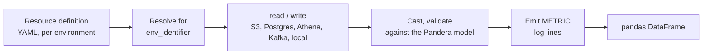

<div class="dynamicio-hero" markdown>
{ width="420" }
</div>

# dynamicio

**Configuration-driven I/O for `pandas` dataframes.** Declare *where* a dataset lives in YAML, declare *what* it looks
like as a [Pandera](https://pandera.readthedocs.io) model, and read or write it with the same two lines of Python in
every environment.

!!! note "pandas only"
    Dataframe execution supports `pandas`. Polars is not supported.

## The problem

A production `pandas` pipeline spends much of its code on I/O: `boto3` for S3, `SQLAlchemy` for Postgres,
`awswrangler` for Athena, `confluent-kafka` for Kafka, and per-format keyword arguments for `parquet`, `hdf`, `csv`
and `json`. Add validation, metrics, and a way to run the same code against sample files on a laptop, and the pipeline
turns into glue code that freezes it to the peculiarities of each library
(see [Concepts](getting-started/concepts.md)).

## The abstraction

A **resource definition** is a YAML entry that names a dataset and, per environment, where it lives and in which
format. An **IO class** is a small `UnifiedIO` subclass that carries a **schema**. Business logic only ever calls
`read()` and `write()`:



Switching `LOCAL` to `DEV` to `PROD` is a change of one identifier, not of code. Because a dataset's location is data,
tests run the whole pipeline against sample files and compare the outputs with
[expected files](guides/testing-pipelines.md), with no mocking of external services.

## Why use it

- **One call site per dataset**, whatever the storage or format.
- **Environments as configuration**: the same task runs locally, in development and in production.
- **Schemas as Pandera models**: columns, dtypes, validations and metrics live in one reviewed place.
- **Metrics for free**: distributions are logged as `METRIC` JSON lines you can parse in your log tooling.
- **Test harness**: `dynamicio.testharness` verifies a task's outputs against reference files.

## Supported sources and destinations

| Source | Read | Write | Formats |
|---|---|---|---|
| Local files (`local`, `local_batch`) | yes | yes | `parquet`, `hdf`, `json`, `csv` |
| S3 object (`s3`) and prefix (`s3_path_prefix`) | yes | yes | `parquet`, `hdf`, `json`, `csv` |
| PostgreSQL | yes | yes | tables |
| AWS Athena | yes | no | SQL query results |
| Kafka | no | yes | messages |

Details are in [Supported sources and formats](guides/sources-and-formats.md).

## Install

```shell
pip install dynamicio
# or, in a uv project
uv add dynamicio
```

Python 3.10 to 3.14 is supported. See [Installation](getting-started/installation.md).

## A minimal example

The [quickstart](getting-started/quickstart.md) builds this end to end and runs without any cloud credentials:

```python
from dynamicio import UnifiedIO
from dynamicio.config import IOConfig


class OrdersIO(UnifiedIO):
    schema = Orders  # a pandera.DataFrameModel


config = IOConfig("orders.yaml", env_identifier="LOCAL", dynamic_vars=Settings)
orders = OrdersIO(source_config=config.get(source_key="ORDERS"), apply_schema_validations=True)

orders.write(df)
df = orders.read()
```

## Where next

- [Quickstart](getting-started/quickstart.md) and [Concepts](getting-started/concepts.md)
- Guides: [reading](guides/reading-data.md), [writing](guides/writing-data.md),
  [schemas and validation](guides/schemas-and-validation.md), [error handling](guides/error-handling.md)
- [API reference](reference/index.md)
- [Changelog](changelog.md), [source code](https://github.com/VorTECHsa/dynamicio),
  [PyPI](https://pypi.org/project/dynamicio/), [issues](https://github.com/VorTECHsa/dynamicio/issues)

---

The original logo was illustrated by [Nick Loucas](https://www.linkedin.com/in/nickloucas/); the refreshed logo keeps
its circular I/O motif.
